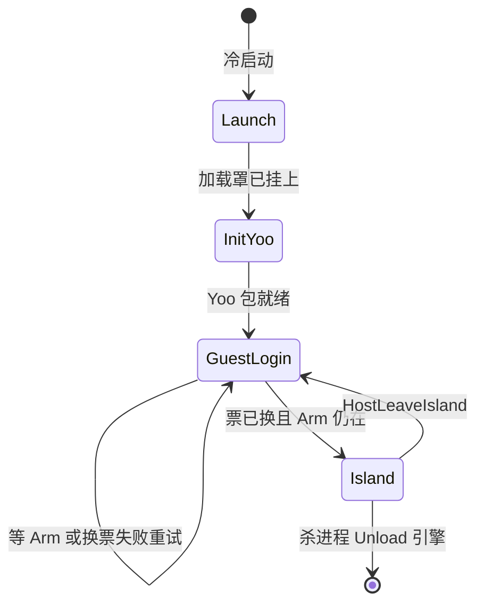
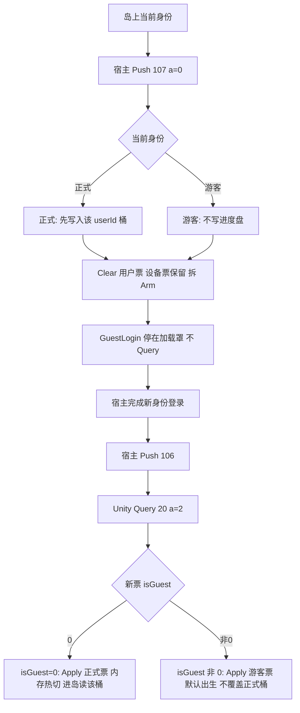
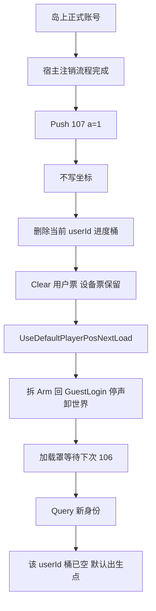
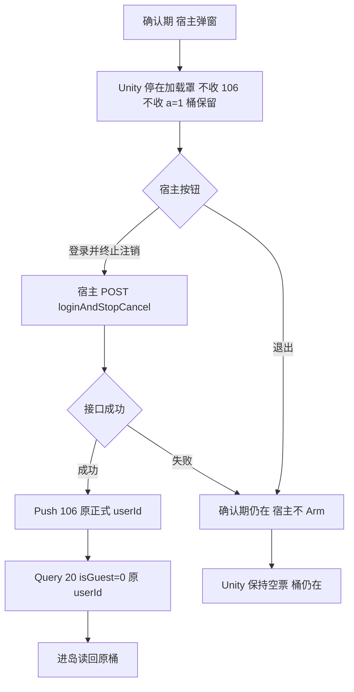

# 登录 / 退登 / 冷启动（GameFramework）

生命周期只有四个流程，入口是 `ProcedureLaunch`。退登不回到 Launch，也不 `LoadScene`，只从 `ProcedureIsland` 切回 `ProcedureGuestLogin`。宿主用两条 Push 插进这条状态机：`HostArmIslandEntry`（106）放行进岛，`HostLeaveIsland`（107）要求离岛。

流程类已经存在，设计落在它们的职责边界上，不新增流程：

- [`ProcedureLaunch`](Assets/GameMain/Procedure/ProcedureLaunch.cs)：只出加载罩
- [`ProcedureInitYooAsset`](Assets/GameMain/Procedure/ProcedureInitYooAsset.cs)：只初始化资源包，并把 GF UI 的资源加载接到 Yoo
- [`ProcedureGuestLogin`](Assets/GameMain/Procedure/ProcedureGuestLogin.cs)：换票、静音创建引擎、等宿主交权
- [`ProcedureIsland`](Assets/GameMain/Procedure/ProcedureIsland.cs)：建世界、揭罩出声、响应退登

`GameEntry` 是组件入口，不是流程。`Awake` 做进程级复位，`OnDestroy` 才 `WanosEngine.Unload`。

## 两套复位，不能混用

进程启动和退登清的东西不同。退登若走 `Awake` 那套 `ResetSession`，会把「已 Load」的音乐 bank 表清掉，重登跳过 `LoadBank`，揭罩后无声。这是参考工程 [`CleanupAudioAfterLeaveIsland`](/Users/sika/Desktop/code/BoluoProject/UnityProject/Assets/Scripts/HotUpdate/Runtime/GameControl.LeaveIsland.cs) 的同一条约束。

进程级（仅 `GameEntry.Awake`，以及 Editor 关域重载）：

- 加载罩、Yoo 模块、原生桥、银行升级、播放列表、内容声、前后台恢复闩全部 `ResetSession`
- `WanosEngine.ResetSession` 只清 C# 开关和 bank 登记，此时引擎还没 `Create`
- 设备 token、磁盘上的进度桶保留

离岛级（`HostLeaveIsland` 同步做完，再允许流程切走）：

- 用户票、本局内存态、负一屏 Arm、内容声、DSP
- 引擎对象、音乐 bank 登记、设备 token、`a=0` 的进度桶留下
- 播放开关、打断标记、恢复闩、播放列表 voice 订阅必须在这一层清掉。现在 `StopEngine` 不停 `_playbackEnabled` / `_eventPostAllowed`，`AudioAppLifecycle._needsRestore` 和 `MusicPlaylist` 的 voice 回调只在 `Awake` 清。离岛后 `IsLoaded` 仍为真，回前台会按「还在岛上」去解 mute

杀进程（`GameEntry.OnDestroy`）：`WanosEngine.Unload`，顺序是 `Stop_All`、`Pause_ALL`、停 DSP、`Destroy`、清 bank 登记。

## 冷启动

时序固定，后面的阶段不回头做前面的事。

1. `SubsystemRegistration`：[`HostIslandEntryGate`](Assets/GameMain/Native/HostIslandEntryGate.cs) 把 106/107 注册上，`_armed = 0`。这一步早于流程，避免进岛 Push 先到被丢掉。
2. `GameEntry.Awake`：进程级复位；`AudioAppLifecycle` 常驻；画质只在真机设一次。
3. `GameEntry.Start`：`InitBuiltinComponents` / `InitCustomComponents`，UI 分组 Main → Panel → Dialog → Tip → Loading（Loading 深度最高）。
4. 框架在帧末进入 `ProcedureLaunch`：`BootLoadingService.Show`。Editor 等 `LoadingForm` 打开，最多 1.5 秒，打不开也继续。
5. `ProcedureInitYooAsset`：初始化 DefaultPackage，检查并下载资源，把 `UIComponent` 的 ResourceManager / UIFormHelper 换成 Yoo。失败记日志后仍然进登录，避免卡死在空流程。
6. 进入 `ProcedureGuestLogin`。Yoo 初始化在同一次进程里只走一遍，退登回来不再进这个流程。

真机冷启动，以及退登后再进入 `ProcedureGuestLogin`、换票还没开始时，若 `internetReachability == NotReachable`，收起加载罩，弹无网，确认后 `GameEntry.Shutdown(Quit)`。进岛之后的局内断网不弹这窗。Editor 不走这条。

## 登录与进岛

`ProcedureGuestLogin` 在换票之前先看门闩。真机 Hybrid 下 `ShouldWaitForHost()` 为真且未 Arm：停在加载罩，不换票。退登回到这里时宿主 token 已经没了，提前换票会锁成 Unity 游客票，下次只 Arm 不再换票，表现为二次进岛无声。

Arm 之后 `RunLogin`：

- 真机：`NativeBridgeFacade.Init` → 读 `boot.json` → `EnsureDeviceTokenAsync` → `EnsureUserTokenAsync` → `GuestSession.SyncFromBoluo`。Hybrid 换票失败保持 Arm，下一帧重跑，不回落本地游客。非 Hybrid 失败才 `ApplyLocalEditorGuest`。
- Editor：已有正式票或游客票就复用；否则停在「编辑器登录」窗。无网不拦截。

换票结束才 `WanosEngine.Load`。已创建则 `KeepSilent` 并返回，不第二次 `Create`。本地解压（`EnsureLocalBanksReadyAsync`）可以跟引擎一起做，那不是 HTTP 下载。

银行下载必须等这次换票成功之后才开始，不和换票并行，也不在 Arm 还没回来时恢复上一轮队列：

- `ProcedureGuestLogin` 只有 `RunLogin` 完成且 `GuestSession.IsLoggedIn` 才调用 `BankUpgradeBootstrap.Start` 和 `BankDownloader.ResumeAfterLeave`。
- Hybrid 换票失败、或换票后 Arm 被拆掉：保持 `PauseForLeave`，不 `Start`、不 `Resume`。
- [`BankUpgradeBootstrap.Start`](Assets/GameMain/BoluoApi/BankUpgradeBootstrap.cs) 现在一进来就把 `_started` 置上。若这一轮 `EnsureUserTokenAsync` 失败，它会跳过 `DownloadBanks` 并直接 return，之后成功换票再 `Start` 会被 `_started` 吃掉，下载永远不再开始。执行时改成：用户票未就绪不置 `_started`，票就绪后再跑升级接口和 `DownloadBanks`。
- `RunAsync` 里在用户票失败时不得进入 `RequestUpgradeBank` / `DownloadBanks`。离岛暂停的队列只在新票落地后 `ResumeAfterLeave`。

进 `ProcedureIsland` 前若 Arm 已被拆掉，协程停掉，标志全部清回「未开始」，继续等下一次 Arm，禁止带着空票进岛。若 `IslandLeaveAssetReclaim.IsBusy`，先等卸包空窗（墙钟上限 8 秒）再切流程，避免 Prefill 和 `UnloadUnused` 抢主线程。

`ProcedureIsland` 内部是阶段，不是新流程：

- Services：UI / Entity 组、Wanos 声组、按 userId `BoluoGameSave.Load`、天气、音量、相机 `InitAndArm`（Prefill 要用恢复后的机位）
- World：加载地形 / 海 / 内水 / 地图物件；近场就绪就继续，远场在后台
- Camera：地形碰撞就绪后重贴脚，避免二次进岛掉到地底
- Hud：先关掉残留的 `IslandMainForm`，再 `OpenUIForm`
- Uncover：罩还盖着时 `EnablePlayback` → `StartEngine` → `Unmute` → `AudioInteractionBootstrap.StartAfterUncover` → `NowPlayingService.ArmSession`。代际 `_uncoverGeneration` 变了就放弃这一轮，避免退登后的淡出拆掉登录罩。淡出后 `NotifyIslandReady`（MsgType 2），宿主才放触摸

揭罩前不出声。这和参考工程「登录页禁声，第一声在进岛首播」一致。

## 退登

按钮和 HTTP 在宿主。Unity 收到 `HostLeaveIsland` 后在同一调用里做完离岛级复位，再请求流程切换。`a=0` 走 `BoluoLogout.ExecuteLeave`（先把坐标写入当前 userId 桶，再清票）。`a=1` 走 `ExecuteAccountDeleted`（清当前桶，不写坐标，下次进岛用默认出生点）。

同步顺序：

1. `HostIslandEntryGate.Reset`，清 `IslandReady`，overlay 触控松开
2. 落盘或清桶，清运行时：下载意图、预设切换、天气内存、摇杆锁、负一屏 `CleanupAfterLeaveIsland`、存档内存
3. 播放列表解绑 voice、作废 generation、`_stoppedByUser = true`。现成的 `MusicPlaylist.ResetSession` 会把 `_stoppedByUser` 置回 false，离岛不能直接调它，否则回前台 `EnsureMusicRestored` 会把曲目拉起来
4. `AudioAppLifecycle` 恢复闩和 `WanosEngine` 打断标记清掉；`_playbackEnabled` 与 `_eventPostAllowed` 置 false。引擎保持 `IsCreated`
5. 进行中的 bank `UnityWebRequest` 中止，磁盘上的半成品保留以便续传。队列停泵，直到下一次换票成功才恢复
6. `ProcedureIsland.RequestReturnToGuestLogin`

下一帧 `ProcedureIsland.OnUpdate`：作废揭罩代际，关 Main / Panel / Dialog / Tip，重新盖上加载罩，`ChangeState<ProcedureGuestLogin>`。`OnLeave`（非杀进程）再做一次幂等停声：`AudioInteractionBootstrap.Shutdown`（环境 / 天气 / 雨水 bank 归还引用）、`WanosEngine.StopEngine`、`World.Release`、`IslandLeaveAssetReclaim`。

`a=0` 留下的：设备 token、该 userId 的进度桶、已载入的音乐 bank、Wanos 逻辑对象（听者 Avatar、Music / Wind / Rain）。`a=1` 额外删掉当前 userId 桶。

环境 bank 允许延后 `UnloadBank`。音乐 bank 留在引擎里。下次揭罩只 `EnablePlayback` + `StartEngine` + `Unmute`，不 `Destroy` 再 `Create`。

## 游客与正式账号换票

真机 Hybrid 上，用户票的源头是宿主，不是 Unity。Unity 不发登录 / 退登 HTTP。两边用两张票：

- `deviceToken`：设备票。退登不清。两边身份共用。过期时 Unity 同步 Query `SessionGetToken`（20），`a=TokenKindDevice`（1），`b` 带强制刷新。blob 是 `expire\ttoken`。
- `userToken`：用户票。退登清掉 Unity 副本。身份在宿主换好之后，Unity 再 Query 同一消息，`a=TokenKindUser`（2）。blob 四段：`expire\ttoken\tisGuest\tuserId`。`isGuest` 为 `0` 是正式账号，非 `0` 是游客。

时序是「宿主先写好票，再 Push 106；Unity 见到 Arm 才 Query」。107 只表示宿主会话已经作废，此时 Query 不到新票，`ProcedureGuestLogin` 停在加载罩上。提前 Query 会在宿主还没票时把 Unity 锁成自己的游客票，下一次 106 不再换票。

原生切账号（游客与正式来回，都是 107 `a=0`，桶按身份取舍）：

游客退出再登正式：

1. 岛上是游客。`Boluo.IsGuest=1`。游客不写进度盘，107 `a=0` 的落盘对游客是空操作。
2. `GuestSession.Clear` 删掉 userToken、userId、IsGuest。设备票和正式账号以前的分桶进度都留着。
3. 流程回到 `ProcedureGuestLogin`，Arm 为 0，不 Query。
4. 用户在宿主完成正式登录。宿主自己持有 `isGuest=0` 的 userToken 和 userId。
5. 宿主 Push 106。`EnsureDeviceTokenAsync` 复用仍有效的设备票。
6. `EnsureUserTokenAsync` Query 用户票。宿主已是正式票，且和 Unity 里空票或旧游客票不一致：先 `Clear`，再 `ApplyUserSession(token, userId, isGuest:false)`。userId 从空变成正式 id，走 `ResetInMemoryForAccountSwitch`，只清内存。进岛 `BoluoGameSave.Load` 读这个 userId 的桶。

正式退出再登游客：

1. 岛上是正式账号。107 `a=0` 在清票之前把坐标写入该 userId 的桶，然后 `Clear` 用户票。这个桶留在磁盘上。
2. 同样拆 Arm，停在加载罩，不 Query。
3. 用户在宿主走游客登录。宿主持有 `isGuest=1` 的票。
4. 106 之后 Query 得到 `isGuest!=0`。`ApplyUserSession(..., isGuest:true)`。userId 变了，内存再热切一次。
5. `AllowsAccountProgressDisk` 对游客为假。这次进岛用默认出生点，不读、也不覆盖刚才留下的正式账号桶。
6. 以后再登回同一个正式 userId，Query 带回原来的 id，`Load` 读回那一桶。

106 到了但 Query 仍是空票：Hybrid 停在罩上重试，最多按 `ProcedureGuestLogin` 的循环再要。这个窗口里禁止用 Prefs 里的旧游客票，也禁止 Unity 自己 `POST touristLogin`。当前 [`EnsureUserTokenAsync`](Assets/GameMain/BoluoApi/BoluoDeviceLoginClient.cs) 只在 Prefs 里还留着游客票时失败返回；107 已经 `Clear` 之后，宿主空 blob 会落到 `RequestTouristLoginAsync`。契约是空 blob 直接失败，等宿主票就绪。

Editor 没有 Query 20。登录窗把票直接写入 `BoluoSession`：游客 `isGuest=true`（远端 touristLogin 或本地 `editor_guest_`），手机号登录 `isGuest=false`。退登清掉用户票后，下次 Play 不再复用上一种身份，停在登录窗。

## 注销与取消注销

这两件事不走同一条原生消息。Unity 没有「取消注销」opcode。

注销已经成功：宿主自己把账号注销流程走完，再 Push `HostLeaveIsland`，`a=1`。Unity 不发注销 HTTP。`HostIslandEntryGate.Leave` 走 `BoluoLogout.ExecuteAccountDeleted`：不写坐标，`ClearAccountBoundProgress` 删掉当前 userId 的进度桶（含无后缀旧键），再 `GuestSession.Clear`。`UseDefaultPlayerPosNextLoad` 置位。然后和普通退登一样拆 Arm、回 `ProcedureGuestLogin`、停声、卸世界。设备票保留。下次 106 若是别的身份，按上一节 Query 新票；这个 userId 的桶已经没了，进岛用默认出生点。

注销确认期（申请了注销、还没到期）：弹窗和 `loginAndStopCancel` 都在宿主。对齐的原生界面是 `CancelConfirmDialog` / `HomeLoginCancelDialogView`。这段时间宿主不推 106，也不推 `a=1`。Unity 停在加载罩上等 Arm，进度桶不动。

- 用户点「登录并终止注销」：宿主调 `/api/commonUser/loginAndStopCancel`，成功后会话仍是这个正式 userId，再推 106。Unity Query `20/a=2` 得到 `isGuest=0` 和原来的 userId。因为没走过 `a=1`，桶还在，进岛按正式账号读回进度。
- 用户点「退出」：宿主清掉自己的登录会话，不 Arm。Unity 用户票保持退登后的空态。这是放弃本次登录，服务端确认期还在，本地桶也不删。

Editor 没有宿主壳，确认期由 [`BoluoPhoneLoginWindow`](Assets/GameMain/Editor/BoluoPhoneLoginWindow.cs) 代替。手机登录响应 `isCancel=true` 时票已经写入 `BoluoSession`，`EditorLoginGate.CancelPendingLogin` 挡住 `ProcedureGuestLogin` 进岛。

- 「登录并终止注销」：Unity 自己 POST `loginAndStopCancel`（Header 带这次的正式 userToken）。成功则清掉 `CancelPendingLogin`，沿用该会话进岛，不清桶。失败则对齐 iOS：清会话，回到登录窗。
- 「退出」：只 `GuestSession.Clear`，清 `CancelPendingLogin`，留在登录窗。不发 107，不清进度桶。

`a=0` 退登、确认期退出、终止注销成功，都保留该 userId 的桶。只有 `a=1` 注销成功才删桶。

## 再进岛

再进岛仍是 `GuestLogin → Island`，不经过 Launch / Yoo。

- 必须等新的 106。旧 Arm 在退登时已拆。
- 注销 `a=1` 清的是当前 userId 桶，并置 `UseDefaultPlayerPosNextLoad`。普通退登不置这个标志。
- 二次进岛 HUD 先关残留 Main，避免两个 `IslandMainForm` 都订预设事件。

Editor 没有宿主 Arm，`ShouldWaitForHost()` 为假，登录窗放行后直接进岛。退登在 Editor 用 [`BoluoAccountLeaveWindow`](Assets/GameMain/Editor/BoluoAccountLeaveWindow.cs) 推同一条 107，不另写一条流程。

## 流程不负责的事

- 不在流程里发退登 HTTP，不在 Unity 里区分「被顶」和「自己退出」，都是 107
- 不在退登 `Unload` 引擎，不在 `Application.quitting` 的 Android 路径上卸引擎（混合壳 `onStop` 会误报退出）
- 界面是 GF `OpenUIForm` + UI Toolkit。`LogoutConfirm` 现在只调 `ExecuteLeave`，没有 `RequestReturnToGuestLogin`，也不该成为真机入口
- 实体组在进岛 `EnsureEntityGroups` 里建好后常驻；岛物体由 `IslandWorldService.Release` 销毁，不靠 `Procedure.Shutdown` 扫实体
