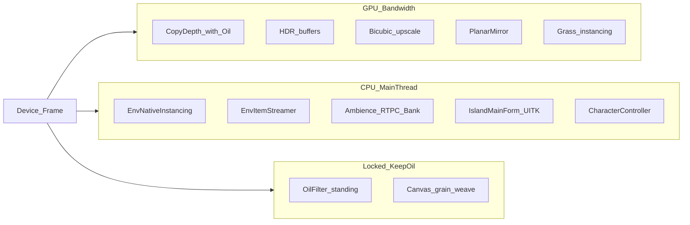

# 真机帧率卡点与改动项（待你拍板）

## 硬约束：油画效果不丢

以下**禁止**作为优化手段（含「站立关、半分辨率、1-tap、关 grain」等会改成片的做法）：

- **OilFilter** 全屏油画边缘（含站立路径）
- **Canvas** grain / weave（Van Gogh PostFX 成片一部分）
- **Oil NPR / 天空 / 雾干刷** 等已定油画外观
- **进一步**扩大「走路跳过 OilFilter」——现状走路已跳过（[`OilFilter.IsEnabled`](Assets/CustomSRP/Runtime/OilFilter.cs) B6）；本次不加深该交易，也不以关滤镜换帧率

允许：不碰滤镜参数、肉眼成片不变的工程优化（带宽/CPU/距离/日志/池化等）。`OIL_MOBILE_PERF` 已有 shader 简化保留；**不再**加「再砍一档油画」的 shader 简化，除非你另开专项并验收成片。

---

## 现状前提（已做、别当新坑再挖）

- `renderScale` 站立/走路统一 **0.5**（弹窗/沉浸 **0.25**）— [`IslandCameraSrpSetup.cs`](Assets/GameMain/Entity/IslandCameraSrpSetup.cs)
- `GameEntry` → Medium + DPI 0.7 + `OIL_MOBILE_PERF`；[`IslandMobileTune`](Assets/GameMain/Services/IslandMobileTune.cs)：硬阴影、非方向光无阴影、shadowDistance 26、云 highRing 关、地形 pixelError 18
- OilFilter：**走路时跳过**（已有交易，本次不扩大）；镜面：走路每 3 帧、MobileScale 0.1
- Bloom/FXAA 默认关；阴影 cascade 1 / atlas 512 / filter Low

**还没对真机 Profiler 采样**——按代码成本推断；拍板后建议先抓一帧再改。

---

## A. GPU / 渲染（油画相关项已剔除或降级为「需成片验收」）

| ID | 卡点 | 位置 | 建议改动 | 代价/观感风险 |
|----|------|------|----------|---------------|
| ~~A1~~ | ~~关/弱化 OilFilter + depth~~ | — | **剔除**：不关站立 OilFilter、不做半分辨率/1-tap | — |
| **A2** ✅ | HDR 中间色缓冲仍开（Bloom 已关） | Asset + [`IslandCameraSrpSetup`](Assets/GameMain/Entity/IslandCameraSrpSetup.cs) `allowHDR=false` | RP Asset + 相机关 HDR→LDR | 高光/雾/油画中间色可能偏；侧车对比成片 |
| **A3** | Planar 水面二次 Cull/Draw | [`OilPlanarReflection.cs`](Assets/CustomSRP/Runtime/OilPlanarReflection.cs) | 走路关镜 / 间隔 5–8 / 静止才开（不影响陆地油画） | 水面镜面感降 |
| **A4** ✅ | `renderScale 0.5` + Bicubic → Linear | CRP Asset `bicubicRescaling: Off` | 升采样改 Linear（不改 OilFilter 参数） | 略糊/锯齿；油画笔触仍在 |
| ~~A5~~ | ~~关 Canvas / ToneMap~~ | — | **剔除**：Canvas 属油画成片；ToneMap 默认不动 | — |
| **A6** | 草/原生实例可视距偏大 | [`EnvStreamingConfig`](Assets/GameMain/Environment/Runtime/EnvStreamingConfig.cs)、OilTerrainGrass | 移动端可视距再砍（如 40–80） | 远景空；近处油画材质不变 |
| **A7** | `farClip=750` | [`IslandCameraSrpSetup`](Assets/GameMain/Entity/IslandCameraSrpSetup.cs) | 压到 300–500 | 极远裁切 |
| **A8** ✅ | 雨粒子移动端仍 ~15k | OilRain settings | `mobileMaxParticles=6000`（3–8k） | 雨稀 |
| **A9** | 阴影 maxDistance 26 / atlas 512 | CRP ShadowSettings | maxDist 15–20 或 atlas 256 | 接触阴影短/糊 |
| **A10** ✅ | Quality 平台默认空 → 启动可能 Ultra | [`QualitySettings.asset`](ProjectSettings/QualitySettings.asset) + [`GameEntry`](Assets/GameMain/GameEntry.cs) | Android/iOS/Standalone 默认 **Very Low**；运行时 `SetQualityLevel(Very Low)` | 启动更稳；与油画无关 |

**说明（depth）**：站立 OilFilter 开启时 depth copy 合理保留；不做「为省带宽关 depth」除非你确认河岸泡沫等可改且成片验收通过。

---

## B. CPU / 游戏逻辑（与油画无关，优先可做）

| ID | 卡点 | 位置 | 建议改动 | 代价/观感风险 |
|----|------|------|----------|---------------|
| **B1** | `EnvNativeInstancing` 每帧 SyncMatrices + Draw | [`EnvNativeInstancing.cs`](Assets/GameMain/Environment/Runtime/EnvNativeInstancing.cs) | 脏标缓存；分格只更近桶；再砍 MaxDist | 远树少；近油画树不变 |
| **B2** | `EnvItemStreamerLite` Instantiate/Destroy | [`EnvItemStreamerLite.cs`](Assets/GameMain/Environment/Runtime/EnvItemStreamerLite.cs) | 对象池；低 FPS 降预算；静止加大 eval 步长 | 进出圈略慢显影 |
| **B3** | Ambience 每帧 RTPC + 水样点线性扫 | [`AmbienceZoneService.cs`](Assets/GameMain/Services/Audio/AmbienceZoneService.cs) | 有 Δ 才写；15–30Hz；水点空间索引 | 衰减略钝 |
| **B4** | 同步 `LoadBank` | [`WanosBankStore.cs`](Assets/WanosAudio/Runtime/Bank/WanosBankStore.cs) | 异步队列；进岛预热；共享 bank 常驻 | 首次进区延迟出声 |
| **B5** | `IslandMainForm` 每帧 style / Equalizer / Timer | [`IslandMainForm.cs`](Assets/GameMain/UI/Forms/IslandMainForm.cs)、[`HudTimerBinder.cs`](Assets/GameMain/UI/HudTimerBinder.cs) | dirty 才写；Timer 跟事件；按 UITK Transform 规范：均衡器 mesh（`HudEqualizerBars`）、专辑/跑马灯 `translate` | UI 动画略糙 |
| **B6** | `CharacterController.Move` vs MeshCollider | [`IslandJoystickCamera`](Assets/GameMain/Entity/IslandJoystickCamera.cs) + EnvMeshColliderLod | 远距 collider 关严 | 近距碰穿风险 |
| **B7** | 进岛后 BankDownloader 主线程 Load | [`BankDownloader.cs`](Assets/GameMain/BoluoApi/BankDownloader.cs) | 进岛暂停 Normal 队列；走路禁 Load | 后台就绪稍晚 |
| **B8** | `PostEvent` / 设备日志 | [`WanosNative.cs`](Assets/WanosAudio/Runtime/Native/WanosNative.cs)、`BOLUO_DEV` | 真机剥 Log | 少调试信息 |
| **B9** | EnvMeshColliderLod 全表扫 | [`EnvMeshColliderLod.cs`](Assets/GameMain/Environment/Runtime/EnvMeshColliderLod.cs) | 分桶只刷脏格 | 实现量中等 |

---

## C. 在「保油画」前提下怎么选

1. **GPU 掉帧且要保油画**：优先 **A4 / A3 / A6–A10**；**A2** 仅侧车对比无差再考虑。
2. **走路卡顿/尖刺**：优先 **B1–B4**（与油画无关）。
3. **低风险快赢**：~~`A4` Linear~~（已做）、`A10` Quality 默认、`B5` UITK dirty、`B8` 剥日志、`B7` 进岛暂停 Load。
4. **明确不做**：关/弱化 OilFilter（原 A1）、关 Canvas / 动 ToneMap 换帧率（原 A5）、加深走路跳过滤镜。

---

## 下一步（等你点名后再执行）

回复要做的 ID（例如 `A4 A3 B1 B5`）。若方便补场景：「站立掉 vs 走路掉 vs 下雨/靠岸掉」。
