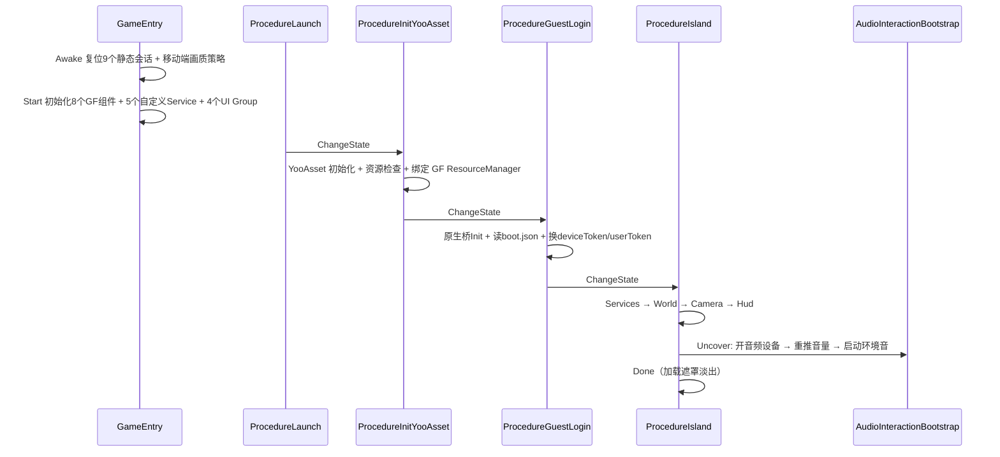

# GameMain 模块总览

> 面向排障的模块地图。每个子文档统一结构：**职责与边界 / 关键文件 / 关键 API / 生命周期与调用链 / 事件表 / 配置与资源依赖 / 日志 tag / 已知坑与排查手法**。
> 找不到具体模块时先看本文末尾的 [日志 tag 总索引](#日志-tag-总索引) 和 [10-bug-index.md](10-bug-index.md)。

## 1. 程序集与边界

| 程序集 | 目录 | 运行时 | 说明 |
|---|---|---|---|
| `Game` | `Assets/GameMain/`（除 `Editor/`） | 是 | 游戏侧全部逻辑，`namespace Game` |
| `Game.Editor` | `Assets/GameMain/Editor/` | 否 | 编辑器工具，**运行时不可引用** |
| `CustomSRP` | `Assets/CustomSRP/` | 是 | 渲染管线。GameMain **不得**直接引用其类型 |

- GameMain → SRP 的唯一通道是接口 [`Services/IAtmosphereVisualDriver.cs`](../Services/IAtmosphereVisualDriver.cs)。
  SRP 侧实现类为 `CustomSRP.OilAtmosphereDriver`。
- GameMain 需要用到 SRP 类型时（草地、云层、CRP 相机）一律走**反射 + 字符串类型名**，
  见 [08-input-camera.md](08-input-camera.md#相机--srp-桥) 与 [04-services.md](04-services.md#islandgrassservice草地)。
  反射失效是静默的（只打日志），改名 SRP 类型不会编译报错，但功能会消失。
- `Assets/WanosAudio/`（`namespace WanosAudio`）是音频引擎封装，GameMain 通过 `WanosEngine` / `WanosInteraction` 门面调用。
  音量 RTPC 硬规则见 [`.cursor/rules/wanos-audio.mdc`](../../../.cursor/rules/wanos-audio.mdc) 与 [`Assets/WanosAudio/README.md`](../../WanosAudio/README.md)。

## 2. 目录与模块映射

| 目录 | 模块文档 | 主要职责 |
|---|---|---|
| `GameEntry*.cs` | [01](01-boot-procedure.md) | 启动、组件注册、热重载复位 |
| `Procedure/` | [01](01-boot-procedure.md) | 启动流程状态机 |
| `Boot/` | [01](01-boot-procedure.md) | 加载遮罩与进度 |
| `YooAsset/` | [02](02-yooasset.md) | 资源包生命周期、GF 资源管理器 |
| `Persistence/` | [03](03-persistence.md) | 存档、坐标保存、游客隔离 |
| `Services/` | [04](04-services.md) | 天气 / 预设 / 氛围 / 世界 / 草地 / 移动端调优 |
| `Services/Audio/` + `Sound/` | [05](05-audio.md) | BGM、环境音、天气音、雨水面采样 |
| `UI/` | [06](06-ui.md) | UI Toolkit 表单框架与 7 个运行时表单 |
| `Environment/Runtime/` | [07](07-environment.md) | MapItem 流式加载、石头碰撞、篝火、原生合批 |
| `Input/` + `Entity/` | [08](08-input-camera.md) | 虚拟摇杆、移动输入、第一人称相机 |
| `BoluoApi/` + `Native/` | [09](09-boluoapi-native.md) | 登录换票、签名、Bank 下载、原生桥 |
| （跨模块坑） | [10](10-bug-index.md) | 已知坑总表与排障流程 |
| （雨视觉） | [11](11-rain-device-visual.md) | 真机雨丝 Editor 有 / 真机无 |

## 3. 启动时序

进度刻度（`BootLoadingService.ReportProgress`）：
`0.05` 启动 → `0.12/0.16/0.22` YooAsset → `0.28~0.48` 登录 → `0.70` `VisualPrepareMin`
→ `0.71` 服务 → `0.72~0.86` 世界 → `0.93` `CameraPrepareMax` → `1.0` `ItemsPrepareMax`。

## 4. 热重载复位清单（Disable Domain Reload）

项目开启了 Disable Domain Reload，`RuntimeInitializeOnLoadMethod` 不会重跑，
**所有跨会话的静态状态必须由 `GameEntry.Awake` 复位**。当前复位清单（[GameEntry.cs](../GameEntry.cs)）：

| 复位调用 | 清掉的静态状态 |
|---|---|
| `BootLoadingService.ResetSession()` | 加载遮罩可见性 / 进度 / 协程 |
| `YooResourceModule.ResetSession()` | YooAsset 包实例（并 `YooAssets.Destroy()`） |
| `LocomotionInput.ClearAll()` | 移动 / 视角输入信箱 |
| `NativeBridgeFacade.ResetSession()` | 原生桥会话、消息路由 |
| `BankUpgradeBootstrap.ResetSession()` | Bank 升级 TCS、启动标志 |
| `BoluoApiEnvironment.ClearCached()` | 网关环境内存缓存 |
| `WanosSoundSetup.ResetSession()` | GF 声音组件辅助类 |
| `MusicPlaylist.ResetSession()` | BGM 串号、当前曲目 |
| `AudioInteractionBootstrap.ResetSession()` | 音频交互启动标志 |

**新增静态单例时必须同步这条清单**，否则会出现「第二次进游戏状态残留」的诡异 bug。

## 5. 事件总表

所有事件都是 `class *EventArgs : GameEventArgs`，由 `ReferencePool.Acquire` → `GameEntry.Event.Fire/FireNow` 派发，
handler 内 `Release`，调用方不 `Release`。

| 事件 | 派发方 | 消费方 |
|---|---|---|
| `WeatherChangedEventArgs` | `WeatherService.SetWeather` | `AtmospherePropService`、`WeatherAudioBridge`、`IslandMainForm`、`WeatherForm` |
| `TimeOfDayChangedEventArgs` | `WeatherService` | `AtmospherePropService`、`IslandMainForm` |
| `IslandWorldReadyEventArgs` | `IslandWorldService.Load` | `AtmospherePropService`、`NowPlayingService`、`NativeBridgeFacade` |
| `PresetChangedEventArgs` | `PresetService.Apply` | `CustomSRP.OilAtmosphereDriver` |
| `PresetTransitionRequestEventArgs` | `PresetService.RequestTransition` | `IslandMainForm`（虹膜过场） |
| `CampfireSuppressChangedEventArgs` | `CampfireWeatherGate.SetSuppressIgnite` | `FireController` |
| `CampfireVisualIgnitedChangedEventArgs` | `CampfireWeatherGate` | `AmbienceZoneService` |
| `NativeTimerEventArgs` | `NativeTimerService` | `IslandMainForm`（计时环） |
| `NativeOverlayEventArgs` | `NativeBridgeFacade` | HUD / 相机 |
| `NativeProfileBadgeEventArgs` / `NativeHealthPressureEventArgs` | `NativeBridgeBootstrap` | HUD |

非 GF 的普通 C# 事件：

| 事件 | 派发方 | 消费方 |
|---|---|---|
| `IslandWorldService.OnInlandWaterReady` | `IslandWorldService` | `AmbienceZoneService`、`RainWaterProximityService` |
| `MusicCatalog.OnCatalogReady` | `MusicCatalog` | `MusicForm` |
| `WanosBankStore.OnBankLoaded` | WanosAudio | `AmbienceZoneService` |
| `WanosInteraction.VoiceStateChanged` | WanosAudio | `AmbienceZoneService` |
| `ScreenLayout.Changed` | `ScreenLayout` | `GameFormLogic`、`IslandMainForm`、`LoadingForm` |
| `NativeOverlayGate.Changed` | `Native` | `NativeBridgeFacade` |

## 6. 两个必须记住的单位陷阱

1. **音量**：UI / 存档层是 **0–1**，引擎 RTPC 是 **0–100**。
   `BoluoGameSave.MusicVolume01 = bgmVolume / 100f`；
   写引擎必须走 `WanosEngine.SetVolumeParameter(param, ui0to1)`（内部 ×100）。
   直接把 0.8 透传 → 0.8% 音量 → **有播放但听不到**。
2. **资源地址**：`SceneAssets.XxxLocation`（运行时 YooAsset 地址，无扩展名）
   与 `SceneAssets.XxxAssetPath`（编辑器 `Assets/...` 路径）是两套东西，不能混用。
   Editor 下 `Base.EditorResourceMode = true` 用的是编辑器路径，所以「Editor 能加载、真机加载失败」十有八九是地址不一致。

## 7. 日志 tag 总索引

| tag | 模块 | 出现场景 |
|---|---|---|
| `[GameEntry]` | 启动 | 画质 / 分辨率 / 移动端策略 |
| `[InitYooAsset]` | 启动 | YooAsset 初始化、LoadingForm 打开结果 |
| `[GuestLogin]` | 登录 | boot.json、游客登录、换票结果 |
| `[ProcedureIsland]` | 流程 | 相机位姿、HUD 打开、超时 |
| `[YooAsset]` | 资源 | 包初始化、下载、地址校验 |
| `[YooGF]` | 资源 | GF 资源管理器加载 / 卸载 |
| `[BoluoGameSave]` | 存档 | 载入结果、迁移 |
| `[IslandPlayerPosSave]` | 存档 | 出生位姿优先级、坐标保存 |
| `[DownloadedUnplayed]` | 存档 | 红点集合载入失败 |
| `[BoluoLogout]` | 存档 | 登出清理 |
| `[IslandWorld]` | 世界 | 世界加载汇总、内陆水 |
| `[IslandGrass]` | 世界 | 草地 sidecar 载入 |
| `[IslandSpawnPose]` | 世界 | 出生位姿解析结果 |
| `[IslandCamera]` | 相机 | CRP 相机配置 |
| `[IslandIdleImmersive]` | UI | 闲置沉浸进出 |
| `[MapItem]` / `[MapItemExtras]` / `[MapItemData]` | 环境 | MapItem 加载、分类统计 |
| `[EnvItemStreamerLite]` | 环境 | 流式初始化、预填充、prefab 缺失 |
| `[FireController]` | 环境 | 篝火焰材质缺失 |
| `[MusicForm]` / `[PresetForm]` / `[UiDialogService]` | UI | 表单业务 |
| `[MusicPlaylist]` / `[MusicCatalog]` | 音频 | 播放、目录加载 |
| `[NowPlaying]` | 音频 | 系统媒体卡片 |
| `[AmbienceZone]` | 音频 | 环境音区评估、bank 加载、音量推送 |
| `[WeatherAudio]` / `[RainWater]` / `[WaterProbe]` | 音频 | 天气音、雨水面、探针重建 |
| `[AudioInteraction]` | 音频 | 交互音频启动 / 关闭 |
| `[DeviceLogin]` / `[BankUpgrade]` / `[BankDownloader]` / `[BankUpgradeBootstrap]` / `[AudioEnginePaths]` / `[SignatureLib]` | API | 登录 / Bank / 签名 |
| `[NativeSession]` / `[IMP]` | Native | 原生桥 |

## 8. 排查入口建议

| 症状 | 先看 | 再看 |
|---|---|---|
| 卡在加载遮罩 | [01](01-boot-procedure.md) | [02](02-yooasset.md) |
| 没声音 / 音量条能动但引擎不变 | [05](05-audio.md) | `.cursor/rules/wanos-audio.mdc` |
| 进岛后 HUD 不出现 | [06](06-ui.md) | [01](01-boot-procedure.md) |
| 走不动 / 掉出地面 / 穿石�� | [08](08-input-camera.md) | [07](07-environment.md) |
| 帧率掉、内存涨 | [07](07-environment.md) | [04](04-services.md) |
| 存档丢失 / 红点不出现 | [03](03-persistence.md) | — |
| 预设切换卡住 / 传送异常 | [04](04-services.md) | [08](08-input-camera.md) |
| 真机资源加载失败 | [02](02-yooasset.md) | [01](01-boot-procedure.md) |
