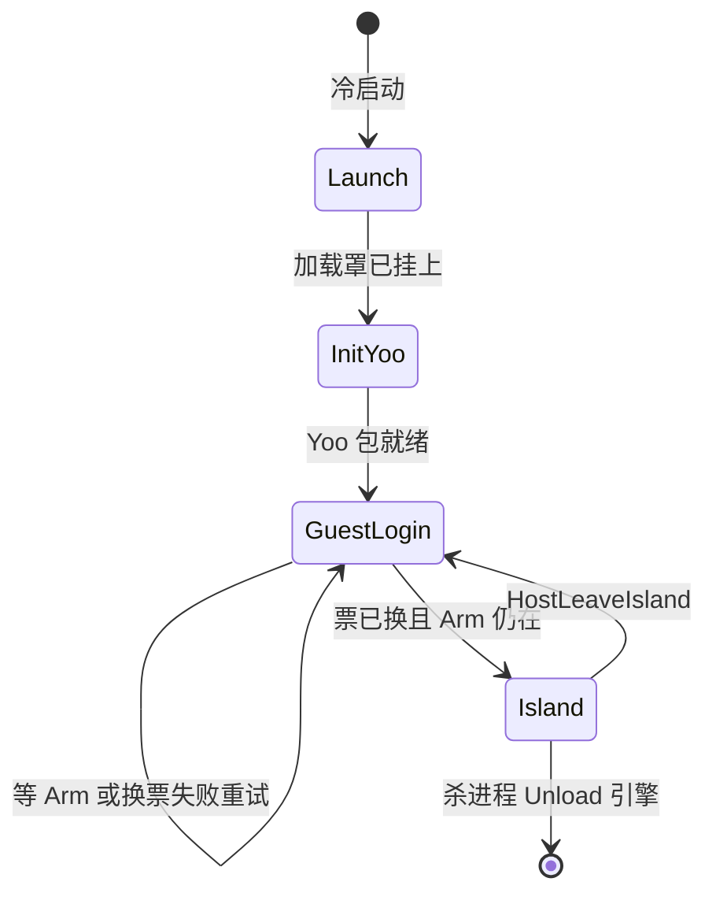

# 会话生命周期（冷启动 / 换票 / 进岛 / 退登）

模块文档索引见 [00-overview.md](00-overview.md)。启动遮罩与 Procedure 内部阶段见 [01-boot-procedure.md](01-boot-procedure.md)，换票与 Bank HTTP 见 [09-boluoapi-native.md](09-boluoapi-native.md)。本文只串「人在哪一阶段、票和声音怎么交接」。

**壳 ↔ Unity 端到端流程图 / 时序图 / 退登竞态**见 Android 文档：[登录进岛退登再登录完整链路.md](../../../../AndroidProject/Docs/登录进岛退登再登录完整链路.md)。

## 职责与边界

四个 `Procedure` 是唯一阶段机，入口是 `ProcedureLaunch`。退登不回到 Launch，也不 `LoadScene`，只从 `ProcedureIsland` 切回 `ProcedureGuestLogin`。

宿主用两条 Push 插进这条状态机：

| 消息 | 值 | 作用 |
|---|---|---|
| `HostArmIslandEntry` | 106 | 宿主交权。Hybrid 下 GuestLogin 见到 Arm 才换票、才进岛 |
| `HostLeaveIsland` | 107 | 离岛。`a=0` 普通退登，保留当前 userId 进度桶；`a=1` 注销成功，清空该桶 |

Unity 不发登录 / 退登 / 注销 HTTP。真机用户票以宿主为准，Unity 在 106 之后用 `SessionGetToken`（20）拉取。设备票退登不清，用户票退登清掉。



Yoo 初始化在同一次进程里只走一遍。退登回来不再进 Launch / InitYoo。

## 关键文件

| 文件 | 作用 |
|---|---|
| [Native/HostIslandEntryGate.cs](../Native/HostIslandEntryGate.cs) | 106/107 早注册；`Leave` 拆 Arm 并请求回 GuestLogin |
| [Native/MsgType.cs](../Native/MsgType.cs) | 106 / 107 / `SessionGetToken` 20 |
| [Native/NativeSession.cs](../Native/NativeSession.cs) | Query 设备票与用户票 blob |
| [Procedure/ProcedureGuestLogin.cs](../Procedure/ProcedureGuestLogin.cs) | 等 Arm、换票、静音创建引擎、启动银行流水线 |
| [Procedure/ProcedureIsland.cs](../Procedure/ProcedureIsland.cs) | 建世界、揭罩出声、响应退登 |
| [Persistence/BoluoLogout.cs](../Persistence/BoluoLogout.cs) | 退登留桶 / 注销删桶 / 离岛级运行时清理 |
| [Services/GuestSession.cs](../Services/GuestSession.cs) | 用户票薄包装；userId 变化时只重置内存 |
| [BoluoApi/BoluoDeviceLoginClient.cs](../BoluoApi/BoluoDeviceLoginClient.cs) | Hybrid 拉宿主票；空票不 `touristLogin` |
| [BoluoApi/BankUpgradeBootstrap.cs](../BoluoApi/BankUpgradeBootstrap.cs) | 升级目录与 `DownloadBanks` 编排 |
| [BoluoApi/BankDownloader.cs](../BoluoApi/BankDownloader.cs) | 离岛 `PauseForLeave`，换票后 `ResumeAfterLeave` |
| [Services/MusicPlaylist.cs](../Services/MusicPlaylist.cs) | `DisarmAfterLeave`：解绑 voice，保持用户已停 |
| [WanosAudio/.../WanosEngine.cs](../../WanosAudio/Runtime/Engine/WanosEngine.cs) | `DisarmPlaybackSession` / `StopEngine` / `Unload` |

## 关键 API

```csharp
// HostIslandEntryGate
static void Arm();
static void Leave(int leaveReason = HostLeaveReasonLogout); // a=1 → ExecuteAccountDeleted

// BoluoLogout
static void ExecuteLeave();            // 先落盘坐标，再清用户票，留进度桶
static void ExecuteAccountDeleted();   // 不写坐标，删当前 userId 桶，再清用户票
static void ResetInMemoryForAccountSwitch(string reason);

// NativeSession
static bool TryGetUserSession(out string token, out bool isGuest, out string userId);
// blob 四段：expire \t token \t isGuest \t userId。isGuest 为 "0" 才是正式账号。

// WanosEngine
static void DisarmPlaybackSession(string reason); // 关播放开关，不 Destroy、不清 bank 登记
static void StopEngine(string reason);            // 先 Disarm，再停 DSP
static void Unload(string reason);                // 仅 GameEntry.OnDestroy / Editor 退出
```

## 生命周期与调用链

### 两套复位

进程启动和退登清的东西不同。退登若走 `Awake` 那套 `ResetSession`，会把「已 Load」的音乐 bank 表清掉，重登跳过 `LoadBank`，揭罩后无声。

进程级（仅 `GameEntry.Awake`，以及关域重载）：加载罩、Yoo、原生桥、`BankUpgradeBootstrap.ResetSession`、播放列表、内容声、前后台恢复闩。`WanosEngine.ResetSession` 只清 C# 开关和 bank 登记，此时引擎还没 `Create`。设备票和磁盘进度桶保留。

离岛级（`HostLeaveIsland` 同步做完，再允许流程切走）：用户票、本局内存、负一屏 Arm、内容声、DSP。引擎对象、音乐 bank 登记、设备票、`a=0` 的进度桶留下。

杀进程：`GameEntry.OnDestroy` → `WanosEngine.Unload`（`Stop_All`、`Pause_ALL`、停 DSP、`Destroy`、清 bank 登记）。

### 冷启动

1. `SubsystemRegistration`：`HostIslandEntryGate` 注册 106/107，`_armed = 0`。早于流程，避免进岛 Push 先到被丢掉。
2. `GameEntry.Awake`：进程级复位；`AudioAppLifecycle` 常驻。
3. `GameEntry.Start`：GF 组件、自定义 Service、UI 组 Main → Panel → Dialog → Tip → Loading（Loading 深度最高）。
4. 帧末进入 `ProcedureLaunch`：打开加载罩。
5. `ProcedureInitYooAsset`：DefaultPackage，并把 GF UI 的资源加载接到 Yoo。失败记日志后仍进登录。
6. `ProcedureGuestLogin`。真机冷启动与退登后再登录，只要还没开始换票且 `NotReachable`，就收起罩、弹无网，确认后 `Shutdown(Quit)`。进岛之后的局内断网不弹这窗。Editor 不走这条。

### 换票

Hybrid（真机且桥可用）必须先等 106。退登回到这里时宿主 token 已经没了，提前换票会锁成 Unity 游客票，下次只 Arm 不再换票。

Arm 之后 `RunLogin`：

- 真机：`NativeBridgeFacade.Init` → 读 `boot.json` → `EnsureDeviceTokenAsync` → `EnsureUserTokenAsync` → `GuestSession.SyncFromBoluo`。Hybrid 换票失败保持 Arm，下一帧重跑，不回落本地游客。
- 宿主 Query 无 userToken：清掉 Unity 里残留的用户票并返回失败，不 `POST touristLogin`。独立包没有宿主时才游客登录。
- Editor：已有正式票或游客票就复用；否则停在「编辑器登录」窗。无网不拦截。

`RunLogin` 结束且 `_finished` 之后才 `WanosEngine.Load`（已创建则 `KeepSilent`，不第二次 `Create`），然后 `BankUpgradeBootstrap.Start` 与 `BankDownloader.ResumeAfterLeave`。本地解压 `EnsureLocalBanksReadyAsync` 跟引擎一起做，那不是 HTTP 下载。

进岛前若 Arm 被拆掉：协程停掉，标志清回「未开始」，`PauseForLeave`，继续等下一次 106。若 `IslandLeaveAssetReclaim.IsBusy`，先等卸包空窗（墙钟上限 8 秒）再切 `ProcedureIsland`。

### 银行下载（契约与现状）

契约：HTTP `DownloadBanks` / `ResumeAfterLeave` 只在换票成功且 `GuestSession.IsLoggedIn` 之后。Hybrid 失败或 Arm 被拆掉时保持 `PauseForLeave`。离岛中止进行中的 `UnityWebRequest`，半成品 `.tmp` 保留。

现状：`ProcedureGuestLogin` 已在 `_finished` 之后调用 `Start` 和 `ResumeAfterLeave`。`BankUpgradeBootstrap.Start` 一进来就把 `_started` 置上。`RunAsync` 里若 `EnsureUserTokenAsync` 失败，会跳过 `DownloadBanks` 并 return，但 `_started` 仍为真。下一次换票成功再 `Start` 会被直接 return，这一轮 HTTP 下载不会重入。

### 进岛

`ProcedureIsland` 内部阶段，不是新流程：Services → World → Camera → Hud → Uncover。

揭罩前、罩还盖着时（`StartAudioBeforeUncover`）：

```
EnsureLocalBanksReadyAsync
EnablePlayback → StartEngine → Unmute
ApplySavedVolumes
AudioInteractionBootstrap.StartAfterUncover
NowPlayingService.ArmSession → PublishPlayingForced
WaitCriticalThenCueAsync（不等待完成）
```

代际 `_uncoverGeneration` 变了就放弃这一轮，避免退登后的淡出拆掉登录罩。淡出后 `NotifyIslandReady`（消息 2），宿主才放触摸。揭罩前不出声。

### 退登 a=0

`HostIslandEntryGate.Leave`：

1. 拆 Arm，清 `IslandReady`，松开 overlay 触控。
2. `ExecuteLeave`：正式账号先把坐标写入当前 userId 桶，再 `ClearRuntimeAfterLeave`，最后 `GuestSession.Clear`。游客不写进度盘。
3. `RequestReturnToGuestLogin`。

`ClearRuntimeAfterLeave`：清下载意图、中止预设/天气、解锁摇杆、`NowPlayingService.CleanupAfterLeaveIsland`（其中 `MusicPlaylist.DisarmAfterLeave` 解绑 voice、作废切歌兜底、`_stoppedByUser = true`）、清 `AudioAppLifecycle` 恢复闩、`WanosEngine.DisarmPlaybackSession`、`BankDownloader.PauseForLeave`、复位坐标/存档/天气内存。

不要在离岛调用 `MusicPlaylist.ResetSession`：它会把 `_stoppedByUser` 抬回 false，回前台会把曲目拉起来。

下一帧 `ProcedureIsland` 作废揭罩代际，关 Main / Panel / Dialog / Tip，盖上加载罩，先 `DestroyImmediate` 运行时网格，再 `UnloadScene` Island。`OnLeave`（非杀进程）再停一次内容声、`StopEngine`。场景物体的 `OnDestroy` 不 `Release` Yoo 句柄。`UnloadSceneSuccess` 且 Island 已经不在之后，才 `Release` 预制体和文本句柄，拆挂在 Launch 相机上的雨幕，回收空闲 UI 池，然后排队 `IslandLeaveAssetReclaim`。卸场景失败且场景还在时不放这些句柄，也不回 GuestLogin。

留下：设备票、该 userId 进度桶、已载入的音乐 bank、听者 Avatar 与 Music/Wind/Rain 逻辑对象。

### 注销 a=1 与确认期

注销已经成功：宿主走完自己的注销流程，Push 107 且 `a=1`。`ExecuteAccountDeleted` 不写坐标，`ClearAccountBoundProgress` 删掉当前 userId 桶（含无后缀旧键），再清用户票，并置 `UseDefaultPlayerPosNextLoad`。设备票保留。然后与普通退登一样拆 Arm、回 GuestLogin、停声、卸世界。下次这个 userId 进岛用默认出生点。

注销确认期（申请了注销、还没到期）的弹窗和 `loginAndStopCancel` 在宿主（`CancelConfirmDialog` / `HomeLoginCancelDialogView`）。Unity 没有「取消注销」opcode。这段时间不推 106，也不推 `a=1`，进度桶不动。

- 「登录并终止注销」成功后，宿主仍持有原来的正式 userId，再推 106。Unity Query 得到 `isGuest=0` 和原 userId，桶还在，进岛读回进度。
- 「退出」：宿主不 Arm。这是放弃本次登录，服务端确认期还在，本地桶也不删。

Editor 没有宿主壳，确认期由 `BoluoPhoneLoginWindow` 代替。`isCancel=true` 时票已写入，但 `EditorLoginGate.CancelPendingLogin` 挡住进岛。「登录并终止注销」由 Unity POST `loginAndStopCancel`；失败则清会话回到登录窗。「退出」只 `GuestSession.Clear`，不发 107，不清桶。

`a=0` 退登、确认期退出、终止注销成功，都保留该 userId 的桶。只有 `a=1` 删桶。

### 游客与正式来回

都是 107 `a=0`，然后等新的 106，再 Query 用户票。

- 游客退出再登正式：不写盘。新票 `isGuest=0` 且与本地空票不一致时先 `Clear` 再 `ApplyUserSession`。userId 从空变成正式 id，`ResetInMemoryForAccountSwitch` 只清内存。进岛 `BoluoGameSave.Load` 读这个 userId 的桶。
- 正式退出再登游客：清票前写入正式桶。新票 `isGuest!=0`。游客 `AllowsAccountProgressDisk` 为假，默认出生，不读也不覆盖正式桶。以后再登回同一个正式 userId，读回那一桶。

Editor 没有 Query 20。登录窗直接写 `BoluoSession`。退登清掉用户票后，下次 Play 不再复用上一种身份。

## 配置与资源依赖

- `Assets/GameMain/Scenes/Launch.unity`：流程类型名序列化在场景 / `GameFramework` 预制体里（`Editor/LaunchSceneSetup.cs`）。
- `StreamingAssets/Game/boot.json`：包名、版本、playMode。
- PlayerPrefs：`Boluo.DeviceToken*` 退登保留；`Boluo.UserToken` / `Boluo.UserId` / `Boluo.IsGuest` 退登删除。正式进度键按 `BaseKey.userId` 分桶。

## 日志 tag

`[IMP] HostIslandEntryGate` `[GuestLogin]` `[ProcedureGuestLogin]` `[ProcedureIsland]` `[BoluoLogout]` `[DeviceLogin]` `[BankDownloader] pause for leave` `[BankDownloader] resume after leave` `[NowPlaying]` `[WanosEngine] playback disarmed`

## 已知坑与排查手法

| 现象 | 原因 | 处理 |
|---|---|---|
| 二次登录无声或进岛身份不对 | 退登后没等 106 就换票，Unity 锁成游客票 | 日志里应停在加载罩，直到 `[IMP] HostIslandEntryGate armed` |
| 退登后回前台又出声 | 离岛没清播放开关或 `_stoppedByUser` 被 `ResetSession` 抬回 false | 应看到 `playback disarmed` 与 `DisarmAfterLeave`；揭罩前才 `EnablePlayback` |
| 重登 Unmute 成功但没声 | 离岛调用了 `WanosEngine.Unload` / `ResetSession`，C# 仍以为 bank 已 Load | 离岛只 `StopEngine`。`Unload` 只出现在 `GameEntry.OnDestroy` |
| 换票成功但银行不再下载 | `Start` 已在更早一次无票时把 `_started` 置上并 return | 见上文「银行下载（契约与现状）」 |
| 注销后再进仍在旧坐标 | 走了 `a=0` 而不是 `a=1`，桶没删 | 107 的 `a` 必须为 `HostLeaveReasonAccountDeleted` |
| 确认期点退出后桶没了 | 误发了 107 `a=1` | 确认期退出不发 107；只有注销成功才删桶 |
