# Bank 下载策略（同意链 / 队列 / 三入口 / 红点 / 自动进场）

模块文档索引见 [00-overview.md](00-overview.md)。底层 HTTP / MD5 / 路径细节见 [09-boluoapi-native.md](09-boluoapi-native.md)；会话离岛暂停见 [12-session-lifecycle.md](12-session-lifecycle.md)；UI 红点与卡片态见 [06-ui.md](06-ui.md)。

本文只写**策略**：谁触发、先过哪些门、怎么排队、完成后怎么跳 / 怎么画红点。

---

## 1. 架构总览

三套触发入口共用同一条用户流水线与同一套磁盘 / 队列：

| 入口 | 触发 | Flow 参数要点 | 完成后 |
|---|---|---|---|
| **区域门** `SceneBankGateSpawner` | 走进 Trigger | `ShowRequestFirst` + 锁移动 + **有**进度窗；`prioritize=true` `preempt=true` | 开固墙 / toast 失败 |
| **预设** `PresetForm` | 点未就绪卡 | **无**进度窗（卡片环）；`prioritize=false` `preempt=true` | pending 命中则自动进预设；否则红点 |
| **音乐** `MusicForm` | 点未就绪曲 | **有**进度窗；`prioritize=true` `preempt=true` | pending 命中则解码后播 |

另有一条**静默启动流水线** `BankUpgradeBootstrap`（Critical / Rest），不走用户流量窗。

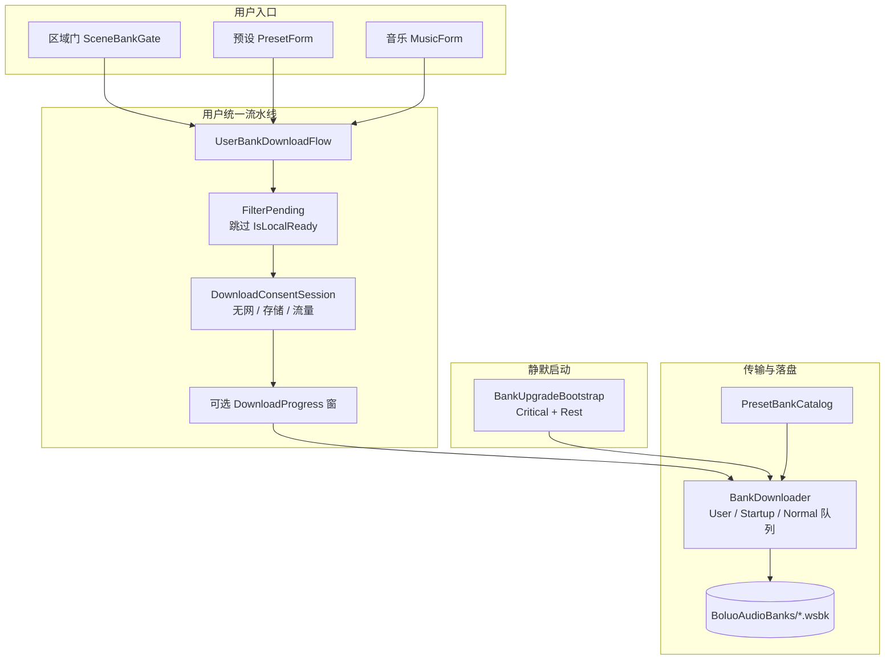

---

## 2. 分层职责

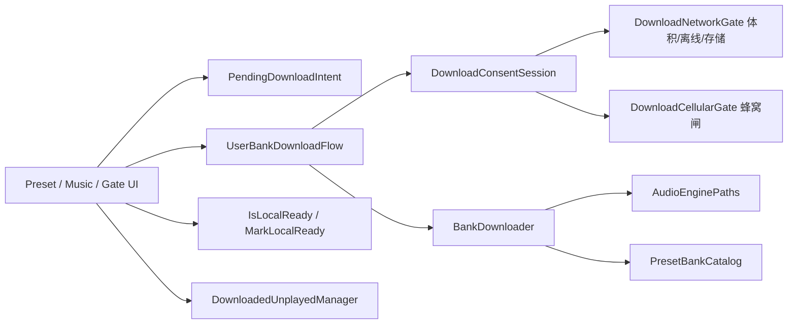

| 层 | 类型 | 职责 |
|---|---|---|
| 意图 | `PendingDownloadIntent` | 最后一次用户点的「下完做什么」：进预设 / 播音乐；两者互斥覆盖 |
| 流水线 | `UserBankDownloadFlow` | FilterPending → 同意链 →（可选进度窗）→ DownloadBanks → onBanksDone → Revoke |
| 同意 | `DownloadConsentSession` | **唯一**弹窗所有者；用户 `EnsureReady` 才弹流量窗 |
| 蜂窝 | `DownloadCellularGate` | WifiOnly / AllowAlways；批次结束 `RevokeCellularAllow` |
| 门禁计算 | `DownloadNetworkGate` | 离线 / 存储×2 / PendingKilobytes 文案 |
| 传输 | `BankDownloader` | 三队列、HTTP、MD5、落盘、载入引擎、`IsLocalReady` 缓存 |
| 目录 | `PresetBankCatalog` + `BankUpgradeClient` | 服务端 upgrade/bank → url/size/md5/version |
| 红点 | `DownloadedUnplayedManager` | 未播 + 24h 首次展示窗；内存始终可判，落盘走账号门控 |

---

## 3. 用户下载主流程

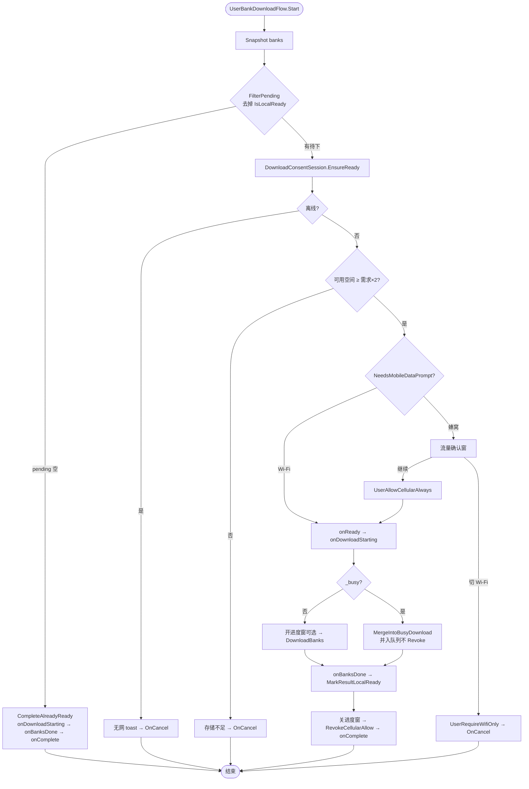

### 策略要点

1. **已落盘不进同意链 / HTTP**：`FilterPending` 用 `BankDownloader.IsLocalReady`；全齐走 `CompleteAlreadyReady`（仍调 `onDownloadStarting` / `onBanksDone`，以便预设自动进场、音乐开播）。
2. **流量窗只服务用户点击**：Rest / 传输层 `NotifyNeedCellularConsent` **只记账不开窗**。
3. **每次 EnsureReady 先 `RevokeCellularAllow`**：上一批发完的 AllowAlways 不跨批次复用。
4. **`_busy` 重叠并入队列**：第二路不丢单、不开第二进度窗、不提前 Revoke；由持有进度窗的那一路 finally 收尾。
5. **完成先 `onBanksDone` 再写正向 ready 缓存**：禁止完成后全量 `InvalidateLocalReadyCache`（多预设并下会把已完成卡刷回「未下载」）。

---

## 4. 时序：单次用户下载（预设为例）

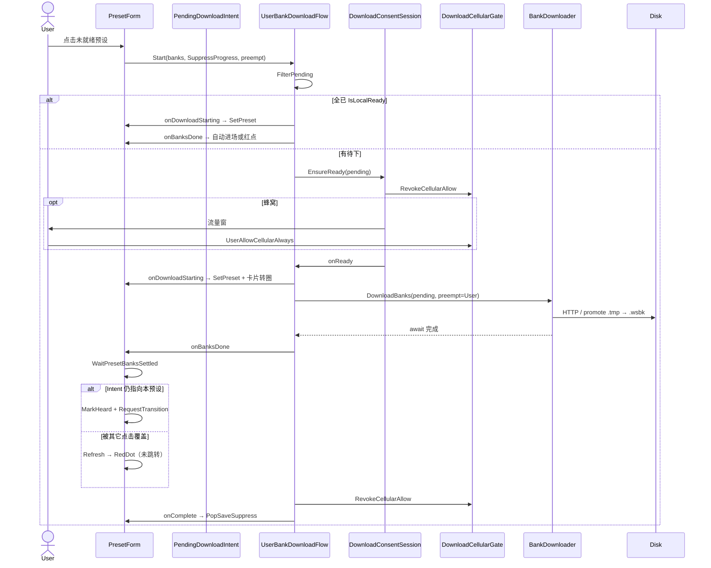

---

## 5. 时序：多预设并下

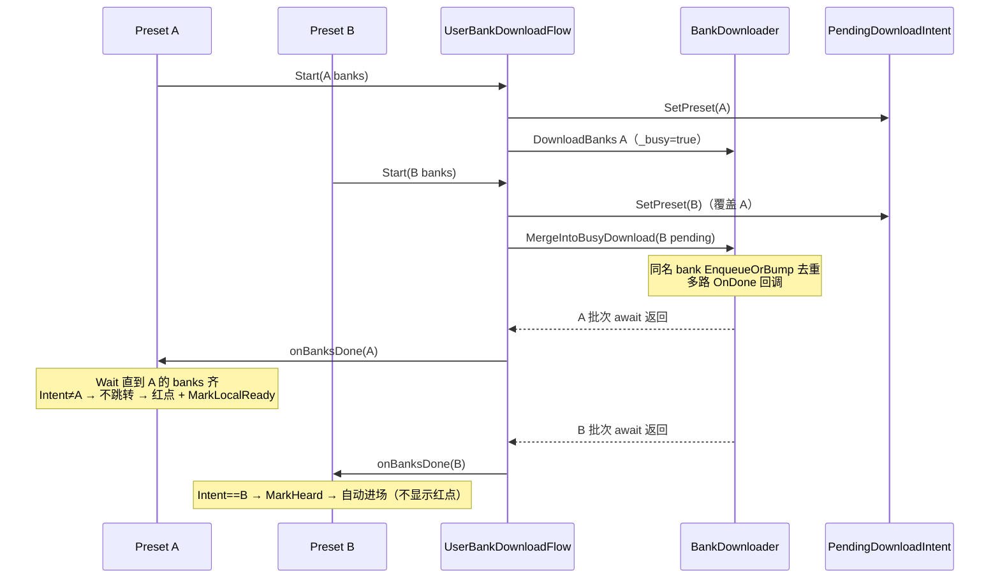

### 策略要点

| 规则 | 说明 |
|---|---|
| Intent 最后点击优先 | 只有 `PendingDownloadIntent.IsPresetMatch` 才自动 `RequestTransition` |
| 未跳转保持完成态 | banks 齐 → `MarkLocalReady` + `ShouldShowRedDot` → `statedownloadsuccess` |
| 已跳转无红点 | 进场前 `MarkHeard` / `MarkPlayed` |
| 未齐且仍 busy | **不清** `_userTriggered`，继续转圈；勿因 2s 超时刷回未下载 |
| Merge 不 Revoke | 第一路 finally 才 `RevokeCellularAllow` + `_busy=false` |

---

## 6. 同意链状态机

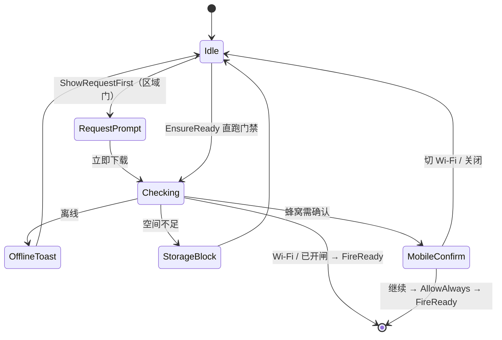

| API | 谁调用 | 是否弹流量窗 |
|---|---|---|
| `EnsureReady` | Flow（用户点下） | 蜂窝时弹 |
| `NotifyNeedCellularConsent` | Rest / 传输打断 | **永不弹**，只合并 bank |
| `ResetForLeaveIsland` | 离岛 / Spawner 重建 | 清会话 |

---

## 7. BankDownloader 队列与就绪判定

### 7.1 三队列优先级

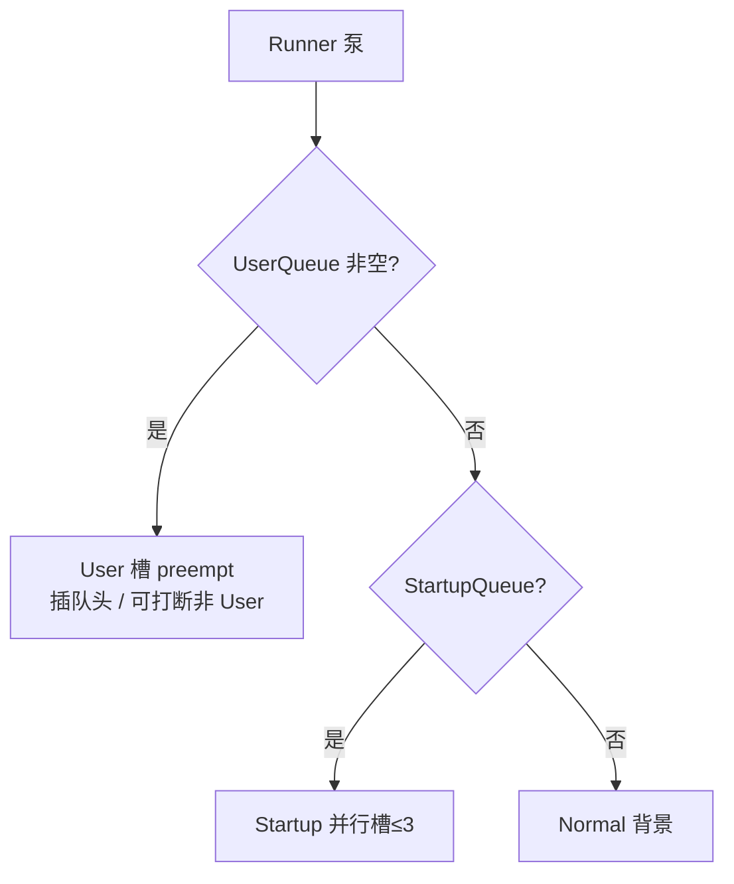

| `DownloadBanks` 参数 | 队列 | 典型调用方 |
|---|---|---|
| `preempt=true` | **User** | 区域门、音乐、预设（点下载） |
| `prioritize=true` 且非 preempt | **Startup** | Bootstrap Critical |
| 两者 false | **Normal** | Bootstrap Rest；预设 `prioritize=false` 但 `preempt=true` 仍走 User |

预设：`prioritize: false, preempt: true` → **User 队列**（插队，但不把 Startup 语义用在卡片上）。

### 7.2 `IsLocalReady` 策略

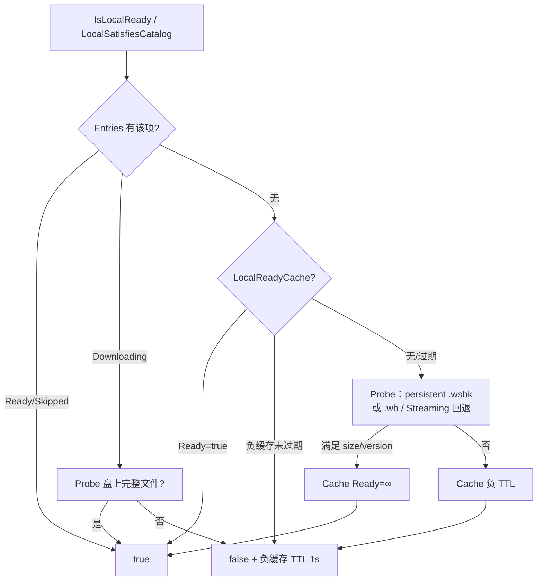

- **Downloading 不盖住完整本地文件**：升级重下时 UI 仍可显示已下载。
- **残缺 `.wsbk` 回退**其它路径，避免半截文件永久「未下载」。
- **`MarkLocalReady`**：下载完成确认后写正向缓存，防止 Entries.Remove / 误 Invalidate 闪回未下载。

### 7.3 落盘与校验（摘要）

1. HTTP → `stem.wsbk.tmp`
2. size 对齐 catalog → promote 为 `.wsbk`
3. 可选 MD5（`BankMd5Cache`）；Streaming `version` 一致可跳过重下
4. `loadIntoEngine` → 载入 Wanos；完成后 `Entries.Remove`

磁盘根：`AudioEnginePaths.PersistentBankPath`（`BoluoAudioBanks`），与音乐 / 区域 / 预设**同目录同 stem**。

---

## 8. 三入口策略对照

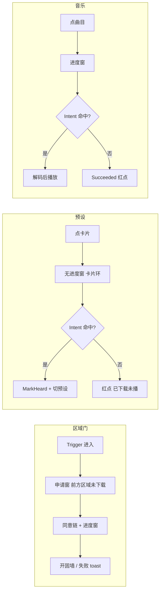

| 维度 | 区域门 | 预设 | 音乐 |
|---|---|---|---|
| 申请窗 | 有（`ShowRequestFirst`） | 无 | 无 |
| 进度窗 | 有 | **无**（`SuppressProgressDialog`） | 有 |
| 锁移动 | 有 + 后退 1m | 无 | 无 |
| 保存抑制 | — | `IslandPlayerPosSave` Push/Pop | 同左 |
| 自动后续 | 开门 | 切预设 | 播放 |
| UI 就绪优先 | `BanksSatisfied` | `IsLocalReady` → RedDot/AllReady/Playing | `IsLocalReady` → Succeeded/Ready |

---

## 9. 预设卡片状态机

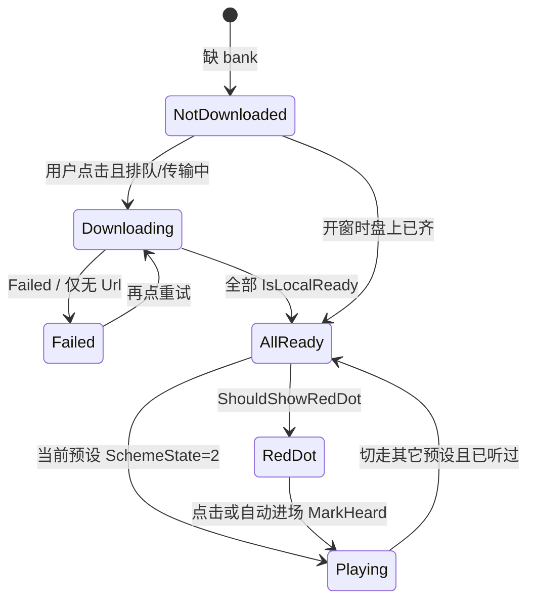

| 状态 | 图标 | 条件 |
|---|---|---|
| NotDownloaded | `statewaitdownload` | 未齐且非本卡用户触发下载 |
| Downloading | 进度环 | `_userTriggered` 且仍有 Pending/Downloading |
| Failed | `stateerror` | Failed 或仅无 Url |
| RedDot | `statedownloadsuccess`（三角+红点） | 全齐 + 未 MarkPlayed + 24h 内 |
| AllReady | `stateready` | 全齐但不显示红点（已听 / 保护过期） |
| Playing | equalizer | `CurrentId` 且 `SchemeState==2` |

红点：`DownloadedUnplayedManager` — **内存始终可显示**；`Persist*` 仍受 `AllowsAccountProgressDisk` 门控（游客不落盘，会话内仍有红点）。

---

## 10. 静默启动（Bootstrap）与用户下载关系

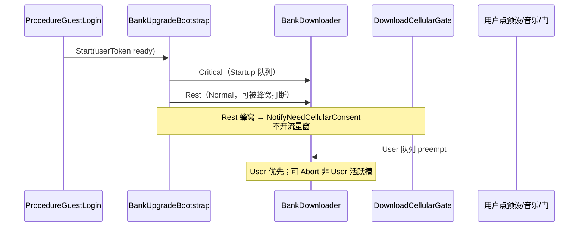

| 波次 | 内容 | 队列 | 流量窗 |
|---|---|---|---|
| Essential 本地 | Common_Init / Common_Music | 不解压 HTTP | — |
| Critical | Music1_1、区域氛围、风雨等 | Startup | 不弹；缺网可 defer |
| Rest | catalog 其余 | Normal | 不弹；记账等用户点下 |

用户点下后与 Rest **共享同一 `BankDownloader` / 同一磁盘**；`FilterPending` 跳过已 Critical/Rest/音乐下过的 stem。

---

## 11. 离岛 / 会话

| 事件 | 下载侧动作 |
|---|---|
| 离岛 | `BankDownloader.PauseForLeave`（Abort 活跃，保留 .tmp）；`PendingDownloadIntent.Clear`；`DownloadConsentSession.ResetForLeaveIsland` |
| 换票后再进 | `ResumeAfterLeave`；`BankUpgradeBootstrap.InvalidateAfterLeave` 后可再 `Start` |
| 退登 | Clear Intent；`DownloadedUnplayedManager.ResetSession` |
| Flow 批次结束 | `RevokeCellularAllow`（不 Abort 队列） |

详见 [12-session-lifecycle.md](12-session-lifecycle.md)。

---

## 12. 关键文件速查

| 文件 | 角色 |
|---|---|
| [Services/UserBankDownloadFlow.cs](../Services/UserBankDownloadFlow.cs) | 用户统一流水线 |
| [Services/DownloadConsentSession.cs](../Services/DownloadConsentSession.cs) | 同意链 / 弹窗唯一所有者 |
| [Services/DownloadUiOptions.cs](../Services/DownloadUiOptions.cs) | 申请窗 / 锁移动 / 抑进度窗 |
| [Services/DownloadNetworkGate.cs](../Services/DownloadNetworkGate.cs) | 离线 / 存储 / 体积 |
| [Services/PendingDownloadIntent.cs](../Services/PendingDownloadIntent.cs) | 下完进预设或播音乐 |
| [BoluoApi/DownloadCellularGate.cs](../BoluoApi/DownloadCellularGate.cs) | 蜂窝闸 |
| [BoluoApi/BankDownloader.cs](../BoluoApi/BankDownloader.cs) | 队列 + HTTP + IsLocalReady |
| [BoluoApi/BankUpgradeBootstrap.cs](../BoluoApi/BankUpgradeBootstrap.cs) | Critical / Rest |
| [BoluoApi/PresetBankCatalog.cs](../BoluoApi/PresetBankCatalog.cs) | 内存 catalog |
| [UI/Forms/PresetForm.cs](../UI/Forms/PresetForm.cs) | 预设下载 / 红点 / 自动进场 |
| [UI/Forms/MusicForm.cs](../UI/Forms/MusicForm.cs) | 音乐下载 / 红点 / 下完播 |
| [Environment/Runtime/SceneBankGateSpawner.cs](../Environment/Runtime/SceneBankGateSpawner.cs) | 区域门下载 |
| [Persistence/DownloadedUnplayedManager.cs](../Persistence/DownloadedUnplayedManager.cs) | 红点集合 |

---

## 13. 日志 tag

`[UserBankDownloadFlow]` `[DownloadCellularGate]` `[BankDownloader]` `[BankUpgrade]` `[BankUpgradeBootstrap]` `[SceneBankGate]` `[PresetForm]` `[MusicForm]` `[DownloadedUnplayed]`

---

## 14. 已知坑（下载专表）

| 现象 | 原因 | 处理 |
|---|---|---|
| 多预设下完闪回未下载 | 完成回调全量 Invalidate / 未齐就清 `_userTriggered` | `MarkLocalReady`；busy 时保持转圈；见 §5 |
| 下完不自动进预设 | Intent 被其它点击覆盖；或 `AreBanksLocallyReady` 偶发 false | 只最后点击进场；`WaitPresetBanksSettled` |
| 已下 bank 仍显示未下载 | 队列 Pending 盖住磁盘；Downloading 强 false | disk-first + Downloading 时 Probe |
| 游客无红点 | 旧逻辑用 `AllowsAccountProgressDisk` 禁显示 | 内存可显示；仅落盘门控 |
| 换票后银行不再下 | Bootstrap `_started` 早置位 | [12](12-session-lifecycle.md) |
| `DownloadBanks` 参数错位 | 与 `DownloadBank` 顺序不同 | **命名参数** |
| Rest 弹流量窗 | 误调 `EnsureReady` | Rest 只用 `NotifyNeedCellularConsent` |

排障总表见 [10-bug-index.md](10-bug-index.md)。
