# Bank 下载策略（同意链 / 队列 / 三入口 / 红点 / 自动进场）

模块文档索引见 [00-overview.md](00-overview.md)。底层 HTTP / MD5 / 路径细节见 [09-boluoapi-native.md](09-boluoapi-native.md)；会话离岛暂停见 [12-session-lifecycle.md](12-session-lifecycle.md)；UI 红点与卡片态见 [06-ui.md](06-ui.md)。

本文只写**策略**：谁触发、先过哪些门、怎么排队、完成后怎么跳 / 怎么画红点。

---

## 1. 架构总览

三套触发入口共用同一条用户流水线与同一套磁盘 / 队列：

| 入口 | 触发 | Flow 参数要点 | 完成后 |
|---|---|---|---|
| **区域门** `SceneBankGateSpawner` | 走进 Trigger | **开** → `ShowRequestFirst`；**关** → 跳过申请；始终 `PriorityBanks(zone)` + **本区进度窗**；开+Wi‑Fi 确认后另 KickSilentAll | 开固墙 / toast 失败 |
| **预设** `PresetForm` | 点未就绪卡 | **无**进度窗（卡片环）；开+Wi‑Fi → 确认后 KickSilentAll + 仅本次等齐；开+流量 → 仅本次 | pending 命中则自动进预设；否则红点 |
| **音乐** `MusicForm` | 点未就绪曲 | **无**进度窗（行内环）；开+Wi‑Fi 同预设 | pending 命中则解码后播 |

另有一条 Bootstrap 后台策略（见 §3 / §10）：关 → 静默全量零弹窗；**开则不主动下**（用户确认 §4.6 后 KickSilentAll）。

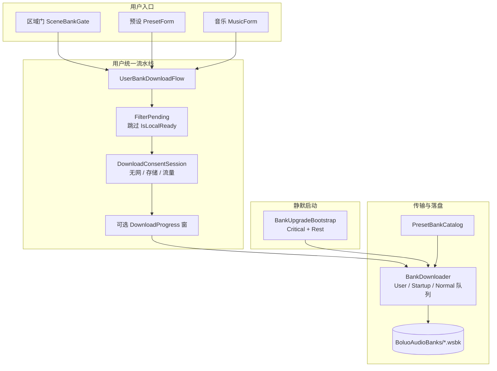

---

## 2. 分层职责

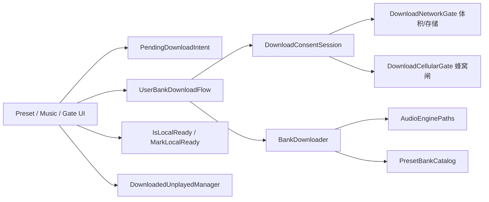

| 层 | 类型 | 职责 |
|---|---|---|
| 意图 | `PendingDownloadIntent` | 最后一次用户点的「下完做什么」：进预设 / 播音乐；两者互斥覆盖 |
| 流水线 | `UserBankDownloadFlow` | FilterPending → 同意链 →（可选进度窗）→ DownloadBanks → onBanksDone |
| 同意 | `DownloadConsentSession` | **唯一**弹窗所有者；无网→存储→蜂窝→（AppLaunch Wi‑Fi 确认） |
| 蜂窝 | `DownloadCellularGate` | 开/关流量确认后均会话开闸到回 Wi‑Fi；关弹窗蜂窝 `EnsureFeatureOffCellularAutoAllow`；离岛复位 |
| 策略 | `BackgroundDownloadPolicy` | 关/开 × Wi‑Fi/流量 / 切换 / 点过后跳过申请窗 |
| 全量收集 | `BackgroundDownloadCoordinator` | catalog 全部 `!IsLocalReady`；开+Wi‑Fi 同意链体积 / `KickSilentAllIfNeeded` |
| 门禁计算 | `DownloadNetworkGate` | PendingKilobytes / FormatSizeMb / AvailableStorageBytes |
| 传输 | `BankDownloader` | 三队列、HTTP、MD5、落盘、载入引擎、`IsLocalReady` 缓存 |
| 目录 | `PresetBankCatalog` + `BankUpgradeClient` | 服务端 upgrade/bank → url/size/md5/version |
| 红点 | `DownloadedUnplayedManager` | 未播 + 24h 首次展示窗；内存始终可判，落盘走账号门控 |

---

## 3. 统一后台策略表（关/开 × Wi‑Fi/流量）

AppLaunch `feature.cancelAccount`：`1` = 后台弹窗**开**（`wifiConfirmEnabled`），`2` / 缺缓存 = **关**。
宿主每个进程启动强制 `POST /boluo/v1/system/appLaunch` 覆盖 PlayerPrefs；拉失败保留旧缓存。Unity 只读落盘，禁止自打 HTTP。

| 后台弹窗 | 网络 / 边沿 | 行为 |
|---|---|---|
| **关** | Wi‑Fi / 流量 | **静默全量**；**零弹窗**；蜂窝自动开闸；断网静默重试续传 |
| **关** UI | 未完成区域 / 预设 | 进门本区进度窗；仅真实 Downloading（及用户点过）预设/音乐显示进度环 |
| **开** | Bootstrap | **不主动下** |
| **开** | Wi‑Fi 首次点 | §4.6 一次（体积=全部剩余）→ KickSilentAll；入口只 await 本次/本区 |
| **开** | 已点过 §4.6 / 已在下 | **不再弹**申请窗/§4.6；再触发 → **直接进度** |
| **开** | 流量（用户点或后台堵闸） | **弹流量窗**；同意后会话开闸到回 Wi‑Fi；`.tmp` 续传不重下 |
| **开** | WiFi↔流量切换 | 已下完不重下；WiFi 已同意不弹 §4.6；断网静默重试 |
| **Busy** | 区域进度窗占用中再点 | Toast「已有资源包在下载中」（先判再钉 Intent，避免环闪） |
| **列表抢占** | 未下载点预设/音乐（无进度窗软占用） | 抢占 + `abortOtherUser`；同批 `keepBatch` 不自相残杀；Abort 立刻 `FireDone` 放旧 await |
| **区域抢占** | 预设/音乐软占用中走进区域门 | 同软占用抢占：弹本区申请/进度 + `abortOtherUser`；硬占用（已有区域进度票）仍 Toast |
| **同意链连点** | 弹窗期间再 EnsureReady | Capture 先调旧 OnCancel，再挂新 Ready（last-wins） |

区域进度窗 **只统计本区 bank**；`PriorityBanks` 插队。

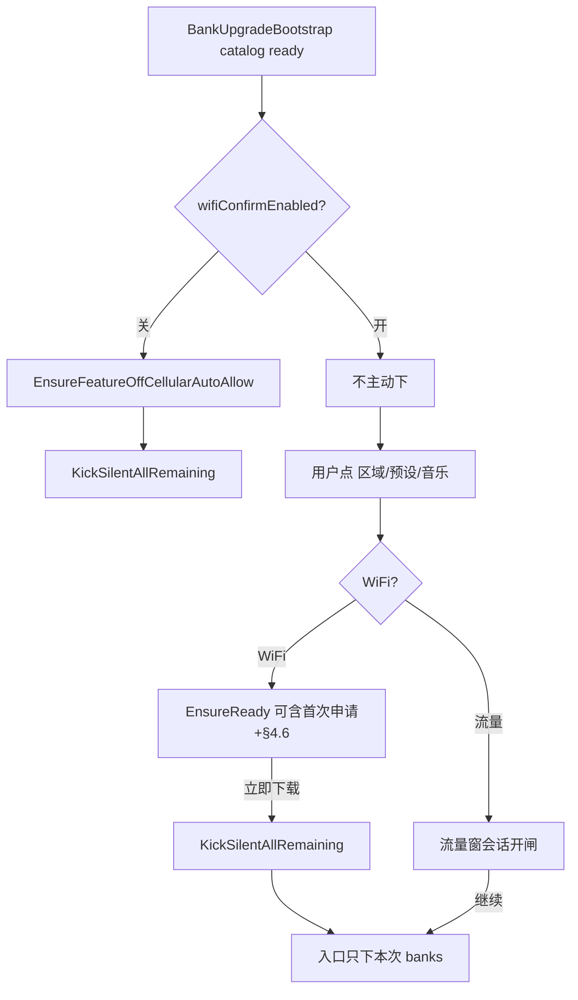

## 3.1 用户下载主流程

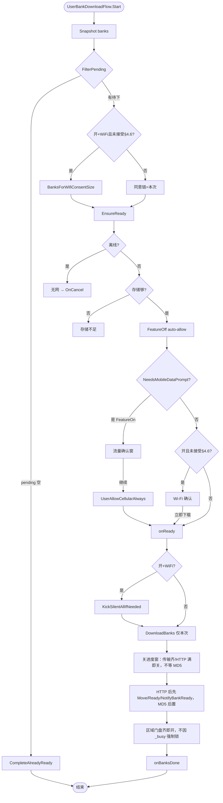

### 策略要点

1. **已落盘不进同意链 / HTTP**：`FilterPending` / `IsLocalReady`；全齐走 `CompleteAlreadyReady`。
2. **关弹窗零确认**：蜂窝 `EnsureFeatureOffCellularAutoAllow`；Bootstrap / EnsureReady 均不弹流量窗。
3. **开 + Wi‑Fi**：§4.6 本岛一次；确认后 KickSilentAll；点过后区域跳过申请窗直接进度。
4. **开 + 流量 / WiFi→流量堵闸**：弹流量窗 → 会话开闸到回 Wi‑Fi；`NotifyNeedCellularConsent` 可弹窗续传。
5. **区域门**：进度/await 只用 ZoneBanks；始终 `PriorityBanks(zone)`。
6. **列表翻牌**：仅真实 `Downloading`（及用户点过的 Pending）→ 进度环；静默入队 Pending 仍未下载；完成须先 `MarkLocalReady` 再 `onBanksDone`；`OnBankLocalReady` force；busy 清除再刷；禁止 epoch 全表刷；粘住未下载靠 epoch 局部自愈。

---

## 4. 时序：单次用户下载（预设为例）

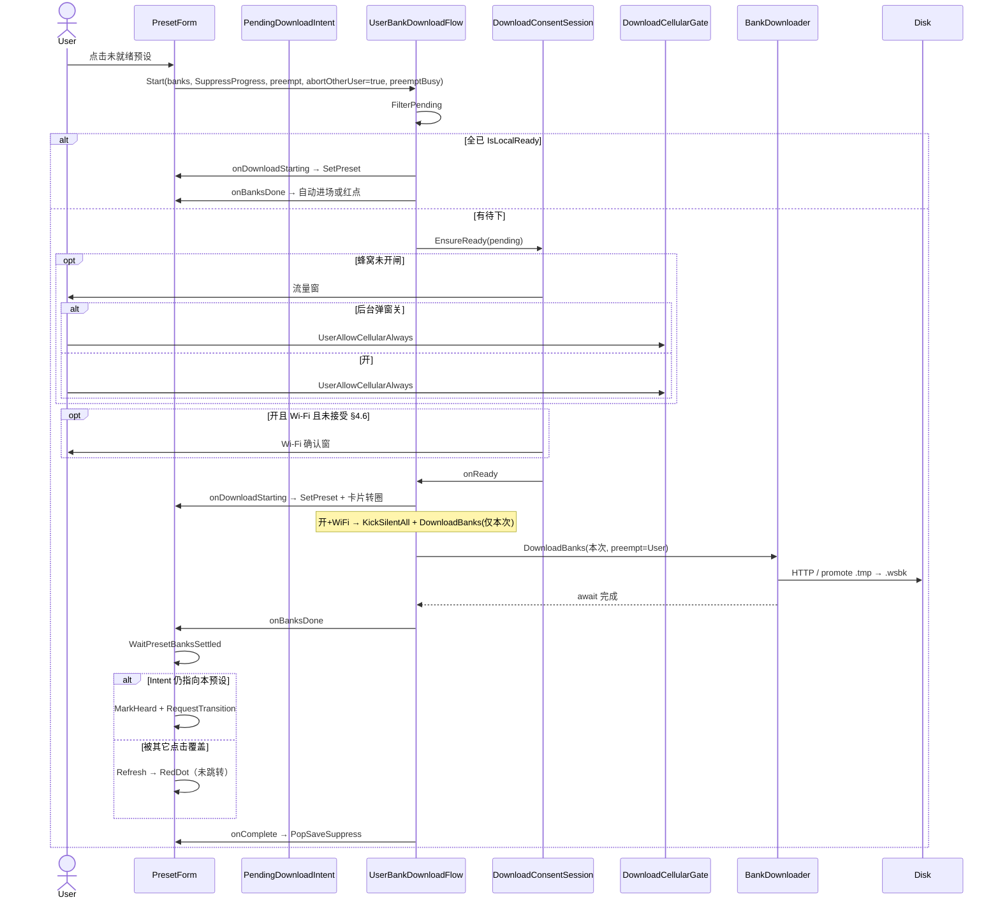

---

## 5. 时序：Busy（硬占用拒绝 / 软占用抢占）

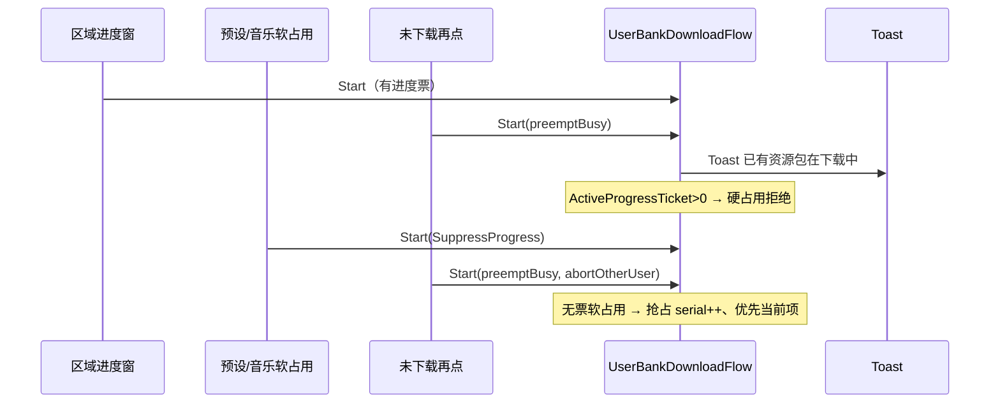

### 策略要点

| 规则 | 说明 |
|---|---|
| 硬占用 | 有 `ActiveProgressTicket`（区域进度窗）→ 新批 Toast「已有资源包在下载中」；入口先 `ShouldRejectNewBatch` 再钉 Intent |
| 软占用抢占 | 无进度票时，预设/音乐/区域门 `preemptBusyBatch` 可抢占；`abortOtherUserDownloads` 打断其它 User |
| 同批白名单 | `DownloadBanks` 快照 `keepBatch`；Abort 跳过本批 Active，避免多 bank 预设自相残杀 |
| 抢占立刻收尾 | `ReleaseWaitersOnAbort` → Abort 后 `FireDone`（保留 `.tmp` 回队续传）；蜂窝 Hold / 离岛 Pause 不 FireDone |
| 同意链 last-wins | 弹窗中再 `EnsureReady`：先旧 `OnCancel`（按 captured id 匹配），再挂新 Ready |
| 同预设再点 | Downloading 且 Intent 已命中 → 只 `PriorityBanks`，不再 `Start` |
| 邻近环境音 | `occupyUserBusy: false`，不挡列表未下载点击 |
| 区域重开进度 | 同一门仅 `TryReopenActiveProgress`，不另起批、不 Toast |
| Intent 最后点击优先 | 只有 `ShouldAutoEnterPreset`（UserClick / HealthRecommend）才 `RequestTransition`；静默 KickSilentAll 落盘**禁止**自动切 |
| 未跳转保持完成态 | banks 齐 → `MarkLocalReady` + `ShouldShowRedDot` → `statedownloadsuccess` |
| 已跳转无红点 | `PresetService.Apply` / 进岛 `RestorePlaybackFromAccount` 记 `MarkPlayed` |
| 未齐且仍 busy | **不清** `_userTriggered`，继续转圈；勿因 2s 超时刷回未下载 |
| FeatureOn 流量会话开闸 | 回 Wi‑Fi 才 revoke；当前 serial 的 finally 才清 `_busy` |

---

## 6. 同意链状态机

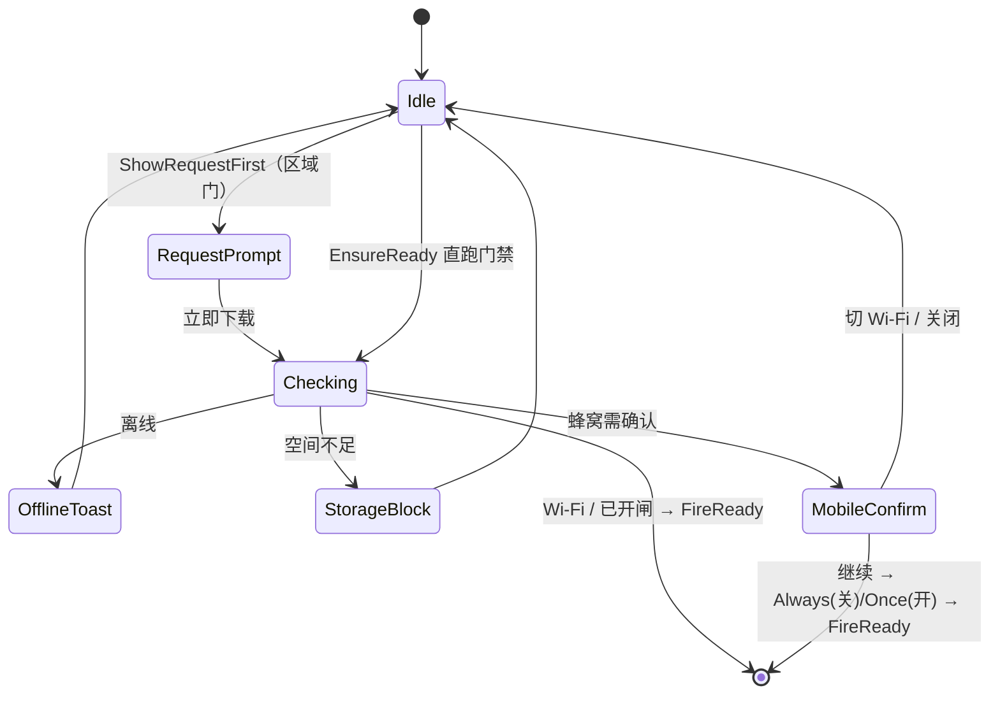

| API | 谁调用 | 是否弹流量窗 |
|---|---|---|
| `EnsureReady` | Flow / 用户点下 | FeatureOn 蜂窝时弹；FeatureOff 自动开闸 |
| `NotifyNeedCellularConsent` | 传输打断 | **永不弹**，只合并 bank |
| `ResetForLeaveIsland` | 离岛 / Spawner 重建 | 清会话 |

---

## 7. BankDownloader 队列与就绪判定

### 7.1 三队列优先级

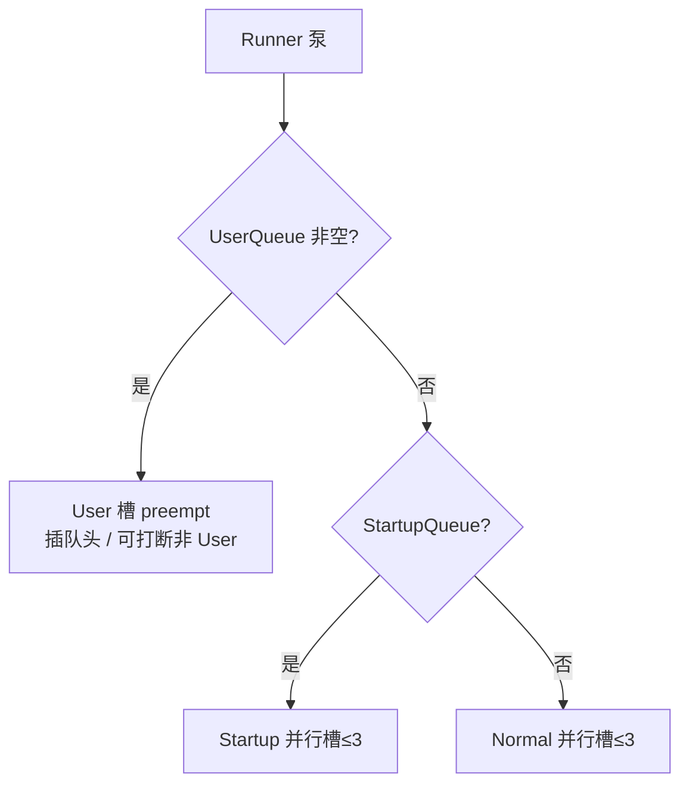

| `DownloadBanks` 参数 | 队列 | 典型调用方 |
|---|---|---|
| `preempt=true` | **User** | 区域门、音乐、预设（点下载）；点击期间单槽 |
| `prioritize=true` 且非 preempt | **Startup** | Bootstrap Critical（并发≤3） |
| 两者 false | **Normal** | 静默 Rest（并发≤3）；预设点下仍是 `preempt=true` → User |

预设/音乐：`preempt: true, abortOtherUserDownloads: true, preemptBusyBatch: true` → **User 队列**（打断 Startup / Normal / 其它 User；`keepBatch` 保同批；抢占 Abort `FireDone` 放旧 await；仅区域进度窗硬占用 Toast 拒绝）。

静默 Rest：`CollectRestRemotes` **Music\* 先于预设/氛围**；Critical 走 Startup≤3，Rest 走 Normal≤3（Critical 排空后再泵；不全开、不全串行）。

### 7.2 `IsLocalReady` 策略

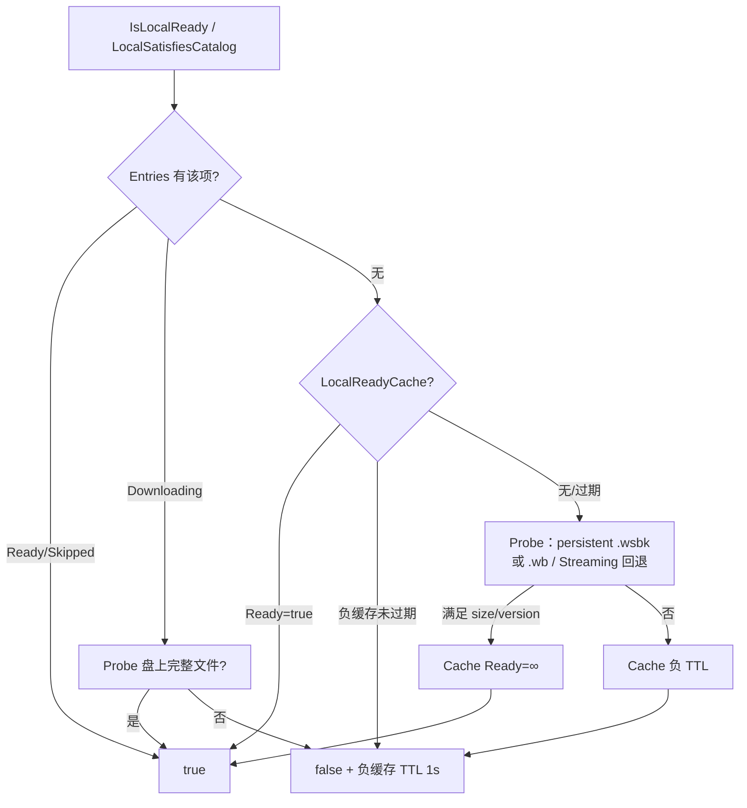

- **Downloading 不盖住完整本地文件**：升级重下时 UI 仍可显示已下载。
- **残缺 `.wsbk` 回退**其它路径，避免半截文件永久「未下载」。
- **`MarkLocalReady`**：下载完成确认后写正向缓存，防止 Entries.Remove / 误 Invalidate 闪回未下载。

### 7.3 落盘与校验（摘要）

1. HTTP → `stem.wsbk.tmp`
2. size 对齐 catalog → promote 为 `.wsbk`
3. 可选 MD5（`BankMd5Cache`）；Streaming `version` 一致可跳过重下
4. `loadIntoEngine` → 载入 Wanos；完成后 `Entries.Remove`

磁盘根：`AudioEnginePaths.PersistentBankPath`（`BoluoAudioBanks`），与音乐 / 区域 / 预设**同目录同 stem**。

---

## 8. 三入口策略对照

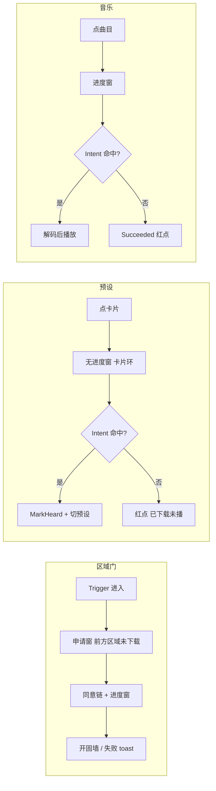

| 维度 | 区域门 | 预设 | 音乐 |
|---|---|---|---|
| 申请窗 | 开：有；关：无 | 无 | 无 |
| 进度窗 | 有（关时进门即弹） | **无**（`SuppressProgressDialog`） | **无**（行内环） |
| 锁移动 | 仅后退 1s；申请/进度窗不冻走（固墙拦住） | 无 | 无 |
| 保存抑制 | — | `IslandPlayerPosSave` Push/Pop | 同左 |
| 自动后续 | 开门 | 切预设 | 播放 |
| UI 就绪优先 | `BanksSatisfied` | `IsLocalReady` → RedDot/AllReady/Playing | `IsLocalReady` → Succeeded/Ready |

---

## 9. 预设卡片状态机

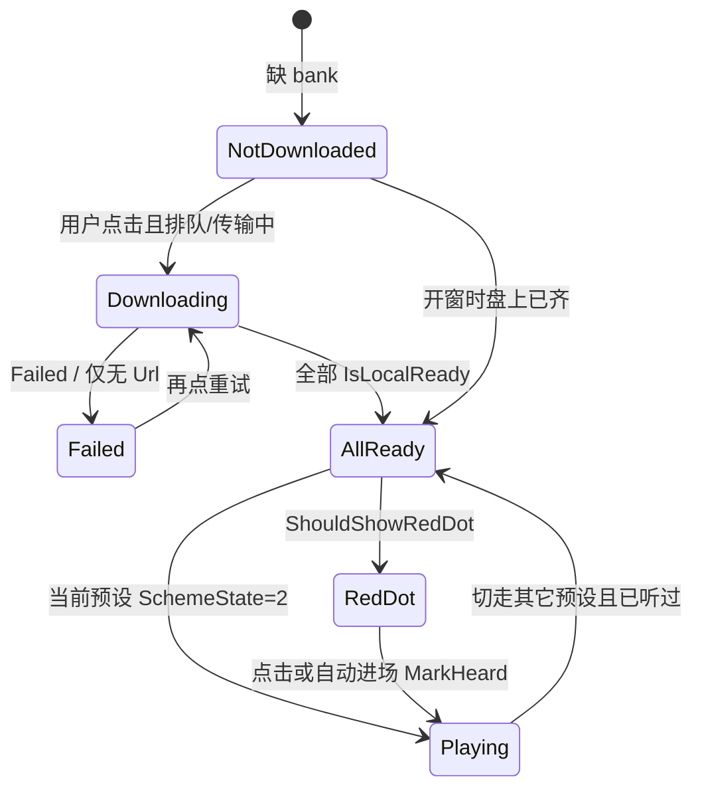

| 状态 | 图标 | 条件 |
|---|---|---|
| NotDownloaded | `statewaitdownload` | 未齐；静默排队 Pending 也算未下载 |
| Downloading | 进度环 | 真实 `Downloading`，或 `_userTriggered` 且仍有 Pending |
| Failed | `stateerror` | Failed 或仅无 Url |
| RedDot | `statedownloadsuccess`（三角+红点） | 全齐 + 未 MarkPlayed + 24h 内 |
| AllReady | `stateready` | 全齐但不显示红点（已听 / 保护过期） |
| Playing | equalizer | `CurrentId` 且 `SchemeState==2` |

红点：`DownloadedUnplayedManager` — **内存始终可显示**；真机 `Persist*` 受 `AllowsAccountProgressDisk` 门控（游客不落盘）；**Editor** 另写 `Boluo.Editor.DownloadedUnplayed`，避免游客退登重进红点回潮。

---

## 10. Bootstrap 与用户下载关系

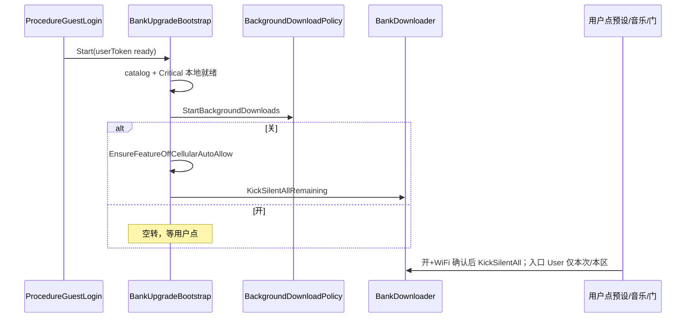

| 波次 | 内容 | 队列 | 弹窗 / 触发 |
|---|---|---|---|
| Essential 本地 | Common_Init / Common_Music | 不解压 HTTP | — |
| Critical∪Rest | catalog 全部待下 | Startup≤3 → Normal≤3（Rest 音乐优先再预设） | **关** → 静默全量零弹窗；**开** → Bootstrap 不下；用户确认 §4.6 后 `KickSilentAll` |
| Critical 判定 | — | — | 只看 `IsLocalReady`（禁止仅凭 Streaming version 跳过） |

用户点下与 Bootstrap **共享同一 `BankDownloader` / 同一磁盘**。

---

## 11. 离岛 / 会话

| 事件 | 下载侧动作 |
|---|---|
| 离岛 | `BankDownloader.PauseForLeave`（Abort 活跃，保留 .tmp）；`PendingDownloadIntent.Clear`；`DownloadConsentSession.ResetForLeaveIsland` |
| 换票后再进 | `ResumeAfterLeave`；`BankUpgradeBootstrap.InvalidateAfterLeave` 后可再 `Start` |
| 退登 | Clear Intent；`DownloadedUnplayedManager.ResetSession`；蜂窝闸复位 |
| Flow 批次结束 | 不 Revoke；蜂窝会话开闸保留到离岛 / 回 Wi‑Fi |

详见 [12-session-lifecycle.md](12-session-lifecycle.md)。

---

## 12. 关键文件速查

| 文件 | 角色 |
|---|---|
| [Services/UserBankDownloadFlow.cs](../Services/UserBankDownloadFlow.cs) | 用户统一流水线 |
| [Services/DownloadConsentSession.cs](../Services/DownloadConsentSession.cs) | 同意链 / 弹窗唯一所有者 |
| [BoluoApi/BoluoAppLaunchCache.cs](../BoluoApi/BoluoAppLaunchCache.cs) | AppLaunch `feature.cancelAccount`（只读宿主每次进程刷新后的缓存） |
| [Services/DownloadUiOptions.cs](../Services/DownloadUiOptions.cs) | 申请窗 / 锁移动 / 抑进度窗 |
| [Services/DownloadNetworkGate.cs](../Services/DownloadNetworkGate.cs) | 存储 / 体积 |
| [Services/PendingDownloadIntent.cs](../Services/PendingDownloadIntent.cs) | 下完进预设或播音乐 |
| [BoluoApi/DownloadCellularGate.cs](../BoluoApi/DownloadCellularGate.cs) | 蜂窝闸 |
| [BoluoApi/BankDownloader.cs](../BoluoApi/BankDownloader.cs) | 队列 + HTTP + IsLocalReady |
| [BoluoApi/BankUpgradeBootstrap.cs](../BoluoApi/BankUpgradeBootstrap.cs) | Bootstrap 策略入口（静默全量 / 空转） |
| [Services/BackgroundDownloadPolicy.cs](../Services/BackgroundDownloadPolicy.cs) | 关/开 × 网络矩阵 |
| [Services/BackgroundDownloadCoordinator.cs](../Services/BackgroundDownloadCoordinator.cs) | 全部剩余 bank 收集 |
| [BoluoApi/PresetBankCatalog.cs](../BoluoApi/PresetBankCatalog.cs) | 内存 catalog |
| [UI/Forms/PresetForm.cs](../UI/Forms/PresetForm.cs) | 预设下载 / 红点 / 自动进场 |
| [UI/Forms/MusicForm.cs](../UI/Forms/MusicForm.cs) | 音乐下载 / 红点 / 下完播 |
| [Environment/Runtime/SceneBankGateSpawner.cs](../Environment/Runtime/SceneBankGateSpawner.cs) | 区域门下载 |
| [Persistence/DownloadedUnplayedManager.cs](../Persistence/DownloadedUnplayedManager.cs) | 红点集合 |

---

## 13. 日志 tag

`[UserBankDownloadFlow]` `[DownloadCellularGate]` `[BankDownloader]` `[BankUpgrade]` `[BankUpgradeBootstrap]` `[SceneBankGate]` `[PresetForm]` `[MusicForm]` `[DownloadedUnplayed]`

---

## 14. 已知坑（下载专表）

| 现象 | 原因 | 处理 |
|---|---|---|
| Busy 时再点 | 旧版 Merge；中曾一律 Toast | 硬占用 Toast；软占用列表抢占优先；见 §5 |
| 多预设下完闪回未下载 | 完成回调全量 Invalidate / 未齐就清 `_userTriggered` | `MarkLocalReady`；busy 时保持转圈；见 §5 |
| 预设下完先未下载、全量完才红点 | `onBanksDone` 早于 `MarkResultLocalReady`；清触发后 force 成云标；busy 期间跳过粘住卡 | Flow 先 Mark 再回调；成功先 force 再清 `_userTriggered`；闲置 epoch 局部自愈 |
| 下完不自动进预设 | Intent 被其它点击覆盖；或 `AreBanksLocallyReady` 偶发 false | 只最后点击进场；`WaitPresetBanksSettled` |
| 已下 bank 仍显示未下载 | 队列 Pending 盖住磁盘；Downloading 强 false | disk-first + Downloading 时 Probe |
| 游客无红点 | 旧逻辑用 `AllowsAccountProgressDisk` 禁显示 | 内存可显示；仅落盘门控 |
| 进入过仍亮红点 | 只在 Form 点选 Mark；虹膜 Apply / 恢复播放未记；Persist 未 Save | `Apply`/`Restore` MarkPlayed；Save 后 `PlayerPrefsSave` |
| 换票后银行不再下 | Bootstrap `_started` 早置位 | [12](12-session-lifecycle.md) |
| `DownloadBanks` 参数错位 | 与 `DownloadBank` 顺序不同 | **命名参数** |
| 开仍自动弹 Critical/§4.6 | Bootstrap 未走 `ShouldBootstrapStayIdle` | FeatureOn 必须空转 |
| 开+流量切换卡住 | Notify 不弹窗 | FeatureOn busy 时 Notify→MobileConfirm |
| 关仍弹流量窗 | Bootstrap/EnsureReady 旧总量窗 | FeatureOff auto-allow |
| 开+WiFi 预设闪回未下载 | 全量塞进 User Flow | 确认后 KickSilentAll；Flow 只用本次 |
| 进度 100% / 关窗后仍过不去 | 旧序 MD5 完才 Ready；`_busy` 强制固墙到 Flow finally | HTTP 后先 Move/Ready/Notify；盘齐不因 busy 锁门 |
| 区域进度变成全量 | Flow pending=全部剩余 | 进度/await 只用 ZoneBanks |
| 区域进度回退/总量缩水 | `PushProgress` 只计 Entries；完成即 Remove | catalog 定总量；`IsLocalReady` 计满 |
| WiFi 全量后区域进度卡住 | 静默 Critical `preempt` 抢 User 队首 | 静默 Critical 仅 Startup，不 preempt |
| 静默全量整表假转圈 | Pending 也当 Downloading | 仅 Downloading / 用户触发 Pending 转圈 |
| 静默翻牌不稳/粘环 | `NotifyBankReady` 只 Invalidate；busy 早退 | 完成 `MarkLocalReady`；busy 清除 force 再刷 |

排障总表见 [10-bug-index.md](10-bug-index.md)。
