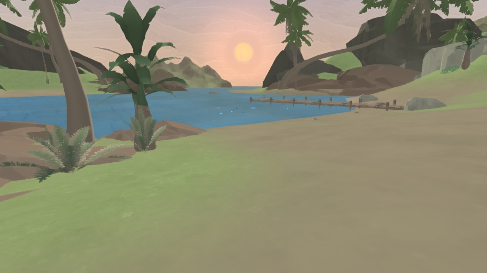
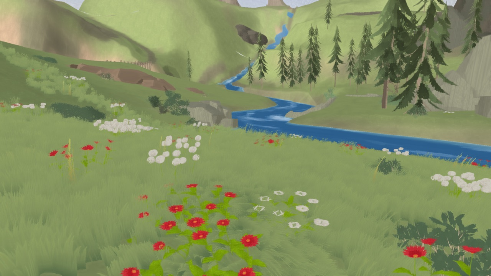
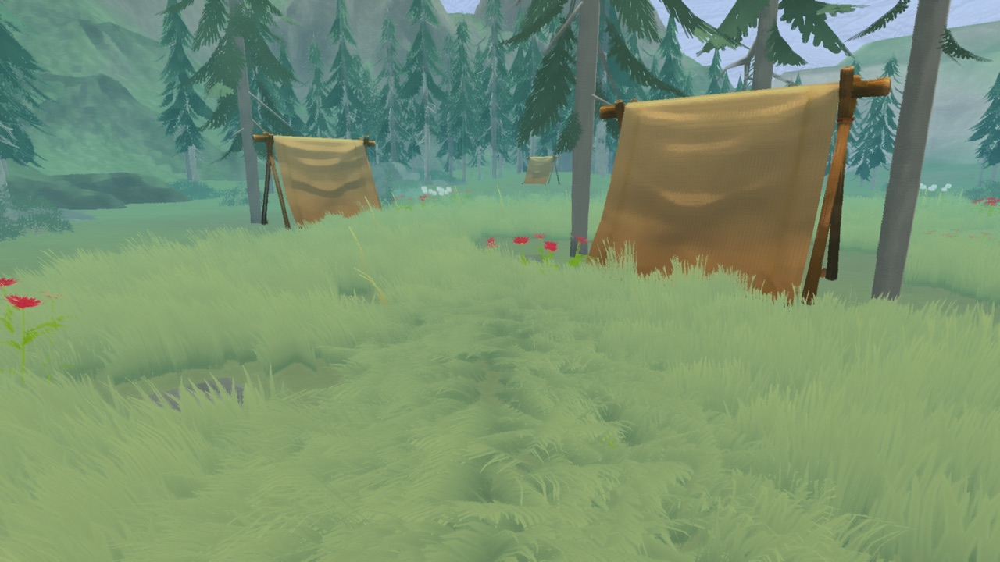
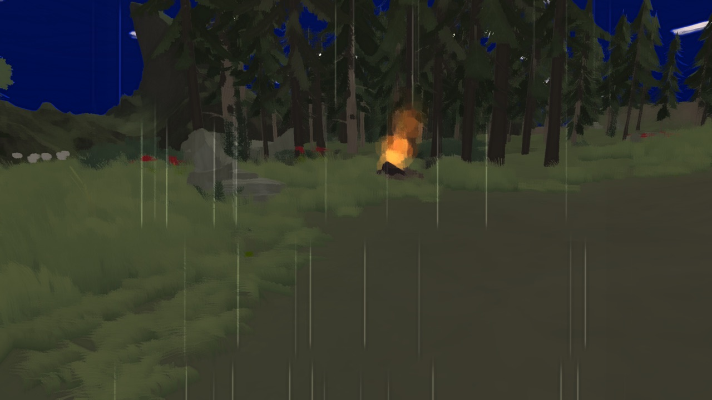
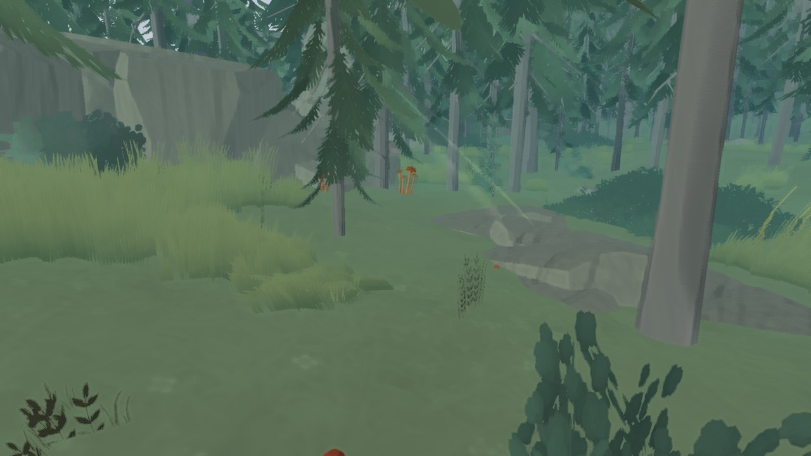
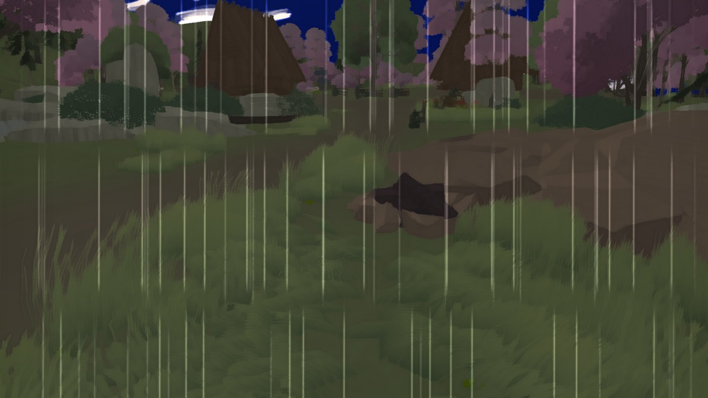
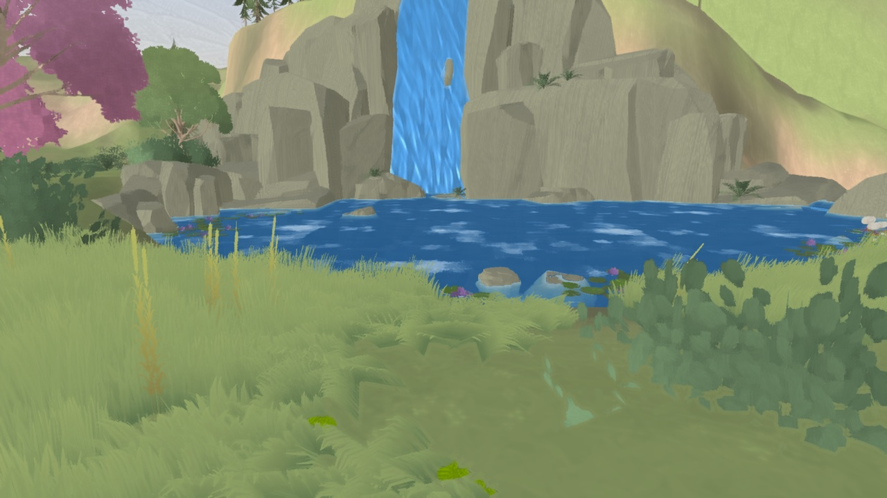
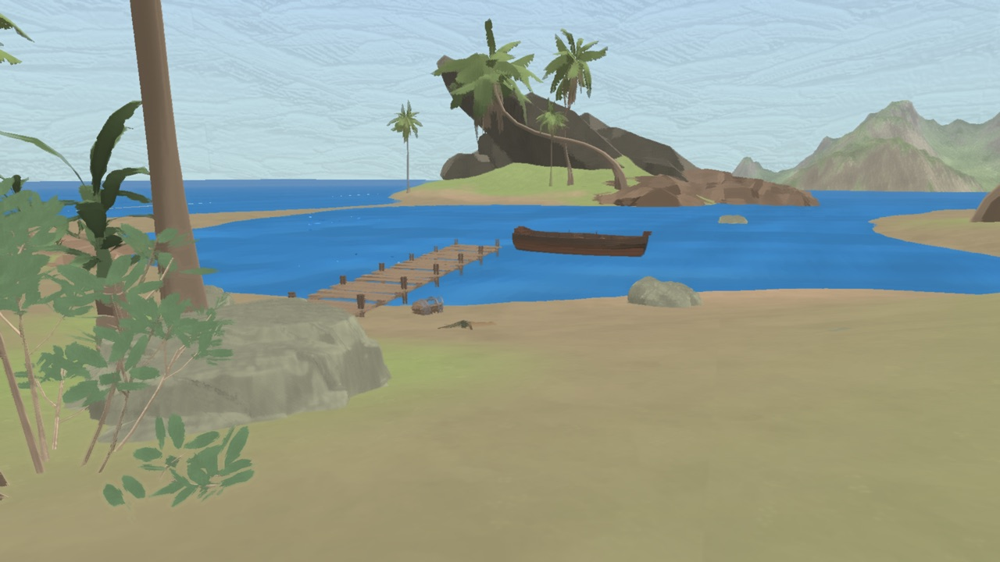
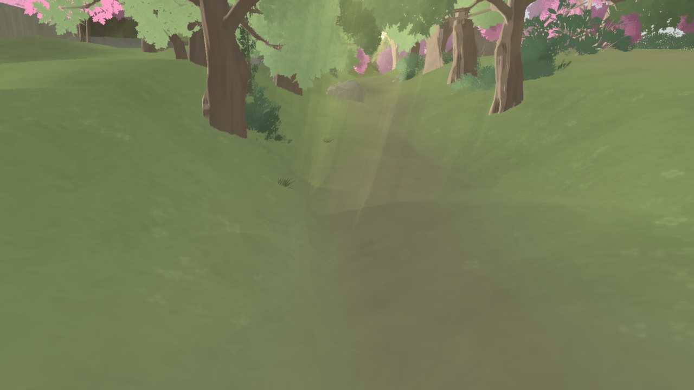
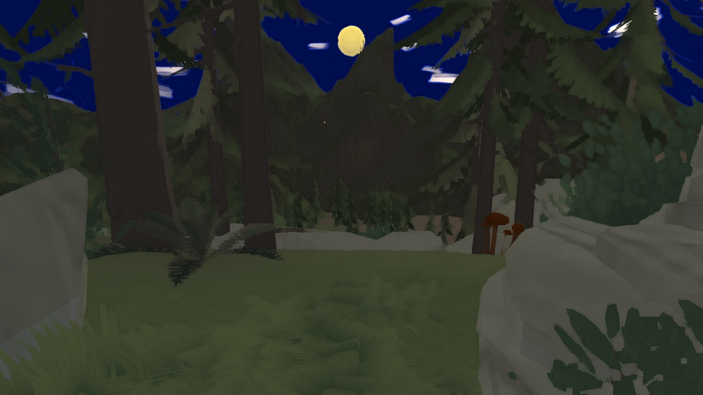

# CustomSRP · 移动端油画风格渲染管线

Unity 6（`6000.6.4f1`）自建 **Scriptable Render Pipeline**（Render Graph），面向移动端的油画 NPR：色块 Albedo、量化明暗、笔触本影、墨线 Outline，无需 URP Renderer Feature。

文档索引：[`doc/README.md`](doc/README.md)  
跨项目约定：[`.cursor/skills/custom-srp/SKILL.md`](.cursor/skills/custom-srp/SKILL.md)

---

## 管线在做什么

```text
CustomRenderPipelineAsset
        ↓
CustomRenderPipeline          # 每帧入口 / Batcher / Linear lights
        ↓
CameraRenderer                # Cull → Lighting/Shadows → Geometry → PostFX
        ↓
OilNPR / TerrainOilNPR        # 物体与地形油画主 Pass（LightMode=CustomLit）
OilOutline                    # 外扩墨线（几何队列先于 CustomLit）
OilSkyboxNPR                  # 四时段油画天空
```

| 层 | 实现 | 移动端要点 |
|----|------|------------|
| 物体 | `CustomSRP/OilNPR` | 量化阶 + 冷暖本影；Outline LOD 150 可关 |
| 地形 | `CustomSRP/TerrainOilNPR` | splat 油画、无 Outline |
| 天空 / 雾 | `OilSkyboxNPR` + `OilAtmosphereDriver` | 时段与天气跟预设走 |
| 草地 | `OilTerrainGrassBinder` | bake 实例 + 预算裁剪 |
| 缓冲 | Render Scale / 关 HDR / 可选 FXAA | 步行自动降到 0.75；关键词 `OIL_MOBILE_PERF` |
| 合批 | SRP Batcher 优先 | 移动构建剥离 `INSTANCING_ON`（OilNPR） |

详细参数与验收：[doc/oil-npr.md](doc/oil-npr.md) · 架构：[doc/architecture.md](doc/architecture.md)

---

## 入口场景

| 场景 | 路径 | 用途 |
|------|------|------|
| **Launch**（游戏入口） | [`Assets/GameMain/Scenes/Launch.unity`](Assets/GameMain/Scenes/Launch.unity) | `EditorBuildSettings` 第 0 位；Procedure → 进岛，挂油画管线 + 10 个氛围预设 |
| **Empty** | `Assets/CustomSRP/Scenes/Empty.unity` | 油画 NPR 单物体验收（Outline / 笔触本影）；菜单 **CustomSRP → Create Empty Scene** |
| **MooreaTerrain** | `Assets/CustomSRP/Scenes/MooreaTerrain.unity` | 1:1 全岛 + TerrainOilNPR + 油画天空；菜单 **CustomSRP → Create Moorea Terrain Scene (1:1)** |

打开工程后：

1. Unity Hub → Open → 本目录  
2. **CustomSRP → Create & Assign Pipeline Asset**（若 Graphics 未挂管线）  
3. 颜色空间 **Linear**  
4. Play **Launch** 进岛，或打开 Empty / MooreaTerrain 验风格

游戏侧程序集：[Assets/GameMain/README.md](Assets/GameMain/README.md)

---

## 岛屿预设示例（无 UI）

Launch 进岛后，10 个手动预设对应不同落点 / 时段 / 天气。下图为无 UI 主相机示例；本仓用 **GameMain → Boluo → 截图 → 各预设 4K 无 UI** 可按当前油画管线重导到 `.tmp/preset_4k/`，再覆盖 `doc/images/presets/`。

| 清晨起床 | 独自旅行 |
|:---:|:---:|
|  |  |

| 午后放松 | 委屈泛滥 |
|:---:|:---:|
|  |  |

| 专注工作 | 放空发呆 |
|:---:|:---:|
|  |  |

| 灵感唤醒 | 假日躺平 |
|:---:|:---:|
|  |  |

| 学习冲刺 | 准备入睡 |
|:---:|:---:|
|  |  |

### 编辑器截图

Play Launch（或已在 Play）后：

- **GameMain → Boluo → 截图 → 各预设 4K 无 UI** — 依次切预设 1–10，藏 UIDocument / Canvas / Debugger，主相机渲 **3840×2160** 到 `.tmp/preset_4k/`
- **GameMain → Boluo → 截图 → 打开 4K 输出目录**
- 也可在工程根写入触发文件 `Temp/capture_preset_4k`（进入 Play 后自动跑）

真机无 UI 桥：运行时 `DevicePresetShotHelper`（adb 写 `preset_shot_cmd.txt`）。

---

## 目录（管线相关）

```text
Assets/CustomSRP/
  Runtime/           # Asset / Pipeline / CameraRenderer / Shadows / PostFX / Grass
  ShaderLibrary/     # Surface / Light / BRDF / Shadows / GI …
  Shaders/           # OilNPR / TerrainOilNPR / OilSkyboxNPR / Lit / Unlit / PostFX …
  Editor/            # 挂管线 + Create*Scene + 油画/草地烘焙
  Scenes/            # Empty / MooreaTerrain + 其它 SRP 单点 demo
Assets/GameMain/
  Scenes/Launch.unity
  Services/          # Preset / Weather / IslandWorld / Grass …
  Editor/            # 预设构建、4K 截图、进岛接线
doc/                 # 场景与管线文档 + images/presets
```

其余 16 个 SRP 能力验证场景（Batcher / CSM / Bloom / FXAA …）见 [`doc/README.md`](doc/README.md)；由 `CustomSRP/Editor/Create*Scene.cs` 生成，不参与发布打包。

---

## Hub 油画 CustomSRP 模版

从本仓打一个**精简** Unity Hub 工程模版（不含 GameMain / 岛屿内容），方便新建油画 NPR 项目：

```bash
python3 Tools/OilCustomSrpTemplate/pack.py
```

输出：`~/Unity user templates/3d-customsrp-oil-npr/`（`unity` 字段必须是完整版本如 `6000.6.4f1`）。  
**完全退出并重开 Unity Hub** → New project（选 **6000.6.4f1**）→ 搜 **3D CustomSRP Oil NPR**。说明见 [`Tools/OilCustomSrpTemplate/README.md`](Tools/OilCustomSrpTemplate/README.md)。

---

## 能力摘要

- **风格**：OilNPR（物体 + Outline）、TerrainOilNPR、OilSkyboxNPR（黎明 / 白天 / 黄昏 / 夜晚）
- **光影**：最多 4 Directional；Other（Point/Spot）+ Forward+；CSM / PCF；油画冷暖本影
- **后处理**：Bloom、Color Grading + LUT、Tone Mapping、FXAA、Render Scale / Bicubic
- **移动端**：`OIL_MOBILE_PERF`、步行 Render Scale 0.75、草地实例预算、Shader 剥离
- **未接 / 待补**：shadow mask 运行时采样、LOD Cross-Fade、Lit Meta / `LIGHTMAP_ON`
